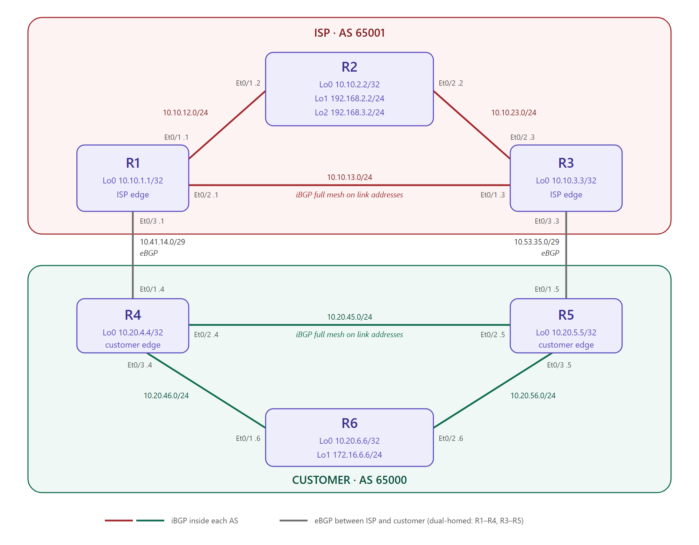
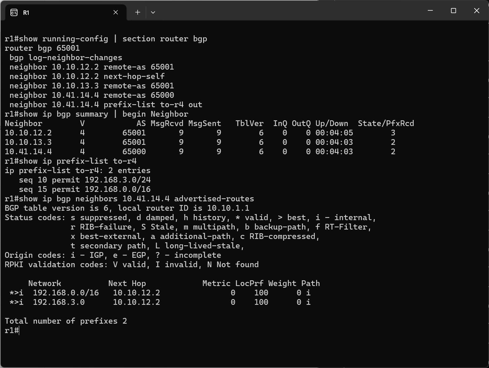
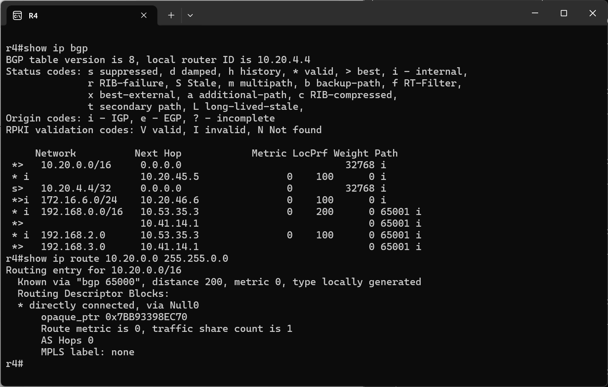
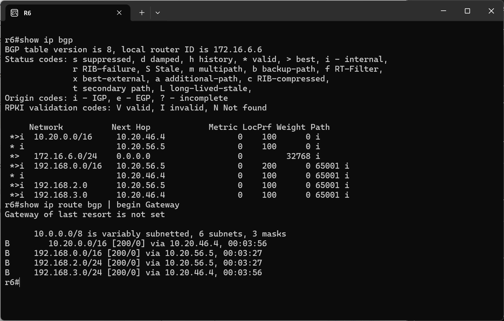
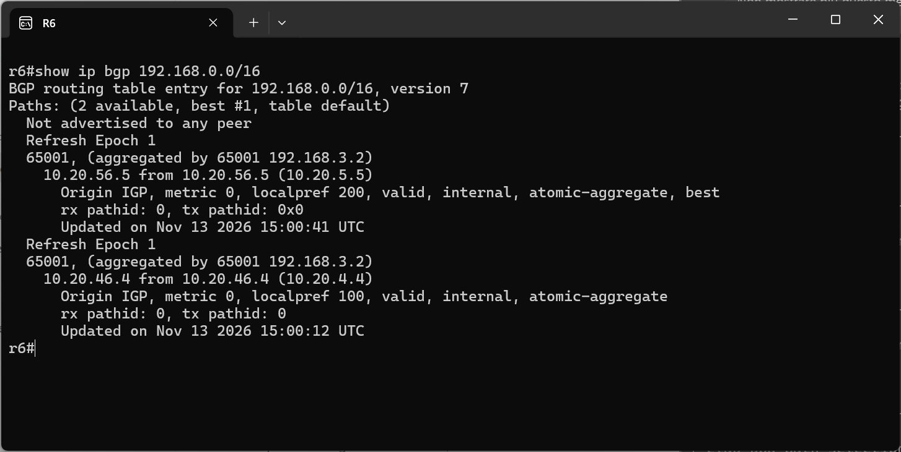
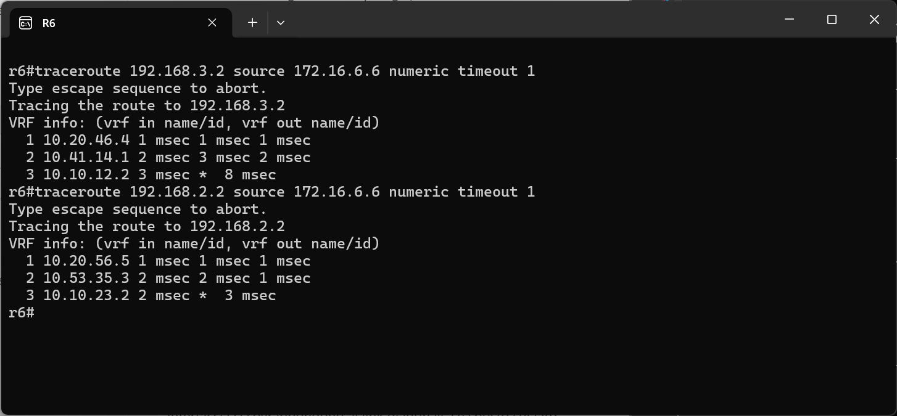
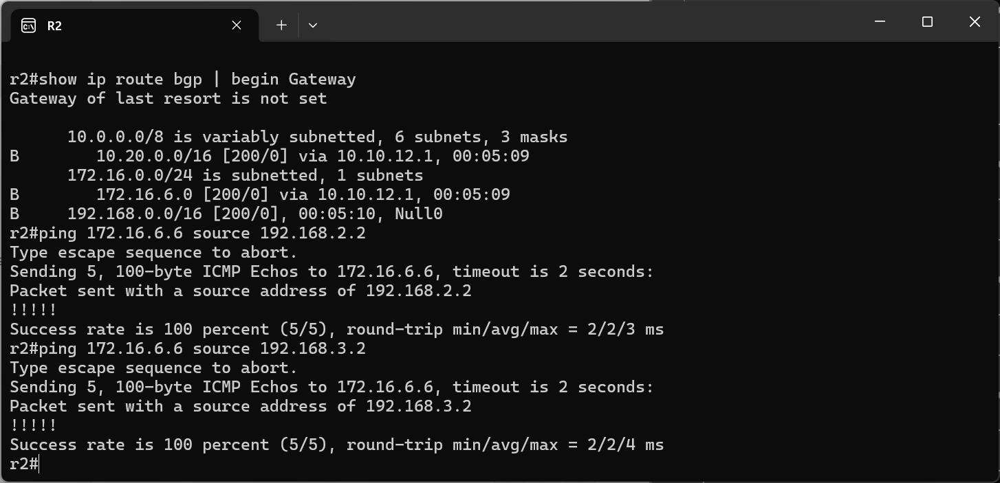

# BGP Path Selection Lab

## Credits

This lab is based on "LAB05 - BGP Path selection" from the ENARSI Hands-On v1.0 course material
by [Magnetico Associazione Culturale](https://www.magnetico.cloud/).

## Topology

A [containerlab](https://containerlab.dev/) topology with 6 Cisco IOL routers split into two autonomous systems: an ISP (AS 65001: R1, R2, R3) and a dual-homed customer (AS 65000: R4, R5, R6). The customer reaches the ISP over two eBGP links, R1–R4 and R3–R5. The lab is about deciding **which of the two links** carries the traffic. Two tools do that: the ISP chooses which prefixes it offers on each link (summaries plus a different specific route per link, so longest match decides), and the customer uses **local preference** to choose its exit for the prefix it receives on both links.



- **ISP, AS 65001**: R1, R2 and R3 form a triangle of /24 links. R2 owns the networks the customer wants to reach, Lo1 192.168.2.2/24 and Lo2 192.168.3.2/24. R1 and R3 are the ISP edge routers.
- **Customer, AS 65000**: R4, R5 and R6 form a second triangle. Every internal link and loopback falls inside 10.20.0.0/16. R6 also has Lo1 172.16.6.6/24, which is outside that block. R4 and R5 are the customer edge routers.
- **eBGP links**: 10.41.14.0/29 (R1–R4) and 10.53.35.0/29 (R3–R5). They are outside both 10.10.0.0/16 and 10.20.0.0/16, so they don't end up in either AS's summaries.

| Config file | Hostname | AS | Lo0 | Other loopbacks | Et0/1 | Et0/2 | Et0/3 | Mgmt IP |
|---|---|---|---|---|---|---|---|---|
| `configs/r1.cfg` | R1 | 65001 | 10.10.1.1/32 | | 10.10.12.1/24 (R2) | 10.10.13.1/24 (R3) | 10.41.14.1/29 (R4) | 172.20.20.10 |
| `configs/r2.cfg` | R2 | 65001 | 10.10.2.2/32 | Lo1 192.168.2.2/24, Lo2 192.168.3.2/24 | 10.10.12.2/24 (R1) | 10.10.23.2/24 (R3) | | 172.20.20.20 |
| `configs/r3.cfg` | R3 | 65001 | 10.10.3.3/32 | | 10.10.13.3/24 (R1) | 10.10.23.3/24 (R2) | 10.53.35.3/29 (R5) | 172.20.20.30 |
| `configs/r4.cfg` | R4 | 65000 | 10.20.4.4/32 | | 10.41.14.4/29 (R1) | 10.20.45.4/24 (R5) | 10.20.46.4/24 (R6) | 172.20.20.40 |
| `configs/r5.cfg` | R5 | 65000 | 10.20.5.5/32 | | 10.53.35.5/29 (R3) | 10.20.45.5/24 (R4) | 10.20.56.5/24 (R6) | 172.20.20.50 |
| `configs/r6.cfg` | R6 | 65000 | 10.20.6.6/32 | Lo1 172.16.6.6/24 | 10.20.46.6/24 (R4) | 10.20.56.6/24 (R5) | | 172.20.20.60 |

containerlab's `ethN` maps to IOL's `Ethernet0/N`. `Ethernet0/0` is always the management interface (in the `clab-mgmt` VRF). The first task of the exercise (`configure replace tftp://...`) isn't needed here: containerlab loads the starting configuration as each node's startup config.

## eBGP and iBGP peering

The starting point has only addresses, with no routing protocol. The first configuration task is to bring up BGP inside each AS and between the two:

```
! R1 (R3 is the mirror image: iBGP to 10.10.13.1 and 10.10.23.2, eBGP to 10.53.35.5)
router bgp 65001
 neighbor 10.10.12.2 remote-as 65001
 neighbor 10.10.13.3 remote-as 65001
 neighbor 10.41.14.4 remote-as 65000

! R4 (R5 is the mirror image: iBGP to 10.20.45.4 and 10.20.56.6, eBGP to 10.53.35.3)
router bgp 65000
 neighbor 10.20.45.5 remote-as 65000
 neighbor 10.20.46.6 remote-as 65000
 neighbor 10.41.14.1 remote-as 65001
```

The **eBGP** sessions run on the /29 addresses. eBGP expects a directly connected neighbor by default (TTL 1), so no `ebgp-multihop` or `update-source` is needed. Inside each AS the routers run a **full mesh of iBGP** sessions. A route learned from an iBGP neighbor is never passed on to another iBGP neighbor (iBGP split horizon), so every router must peer directly with every other router in its AS. Each AS is a triangle of directly connected routers, so the sessions use the link addresses and no IGP is needed to reach the peers. The trade-off is that a session goes down with its link even when a path through the third router exists. Loopback peering with an IGP and `update-source Loopback0` would survive that.

No `bgp router-id` is configured, so IOS picks the highest loopback address. R2's router ID is therefore 192.168.3.2 (Lo2) and R6's is 172.16.6.6 (Lo1), not their Lo0. The ID shows up in the outputs below, for example in the `aggregator` attribute and as the last tie-breaker of the best path selection.

### next-hop-self

A router that passes an eBGP route to its iBGP peers keeps the original next hop. R4 receives the ISP prefixes from R1 with next hop 10.41.14.1 and would hand them to R6 unchanged. R6 has no route to that /29, so it would show the prefixes in `show ip bgp` but never select them (no `>`, `inaccessible` in the detailed output) or install them. The edge routers fix this by advertising themselves as the next hop to their internal peers:

```
! R4
router bgp 65000
 neighbor 10.20.46.6 next-hop-self
! R5
router bgp 65000
 neighbor 10.20.56.6 next-hop-self
! R1
router bgp 65001
 neighbor 10.10.12.2 next-hop-self
```

In this lab `next-hop-self` is configured only where the exercise needs it: toward R6 on both customer edges, and toward R2 on R1. Without the keyword `all`, it only rewrites the next hop of routes learned over eBGP, which is exactly this case. The option `all` also rewrites iBGP-learned routes, which only matters on a route reflector.

On R1 the three sessions are up: both iBGP peers in AS 65001 and the eBGP peer in AS 65000 have a prefix count in `State/PfxRcd` instead of `Idle` or `Active`. The same screenshot also shows the outbound filter toward R4, covered in the [ISP summary section](#isp-summary-and-per-link-filtering):



## A single customer prefix

R4 and R5 must announce the customer to the ISP as one network, 10.20.0.0/16. An ISP doesn't need the customer's internal structure, and a single prefix doesn't flap when an internal link changes. Each edge router uses its own Lo0 as the component of the aggregate:

```
! R4 (R5 uses network 10.20.5.5 mask 255.255.255.255)
router bgp 65000
 network 10.20.4.4 mask 255.255.255.255
 aggregate-address 10.20.0.0 255.255.0.0 summary-only
```

`aggregate-address` creates the summary only while at least one more specific prefix inside it is in the **BGP table**, which is why the `network` statement for the loopback is needed. `summary-only` suppresses the components toward every neighbor, iBGP peers included. Because the loopback never goes down, the aggregate is always announced. A `network 10.20.0.0 mask 255.255.0.0` plus a static route to Null0 would behave the same. With a link subnet as the only component, the aggregate would instead be withdrawn when that link failed. The aggregate is configured on both edge routers, so the customer stays reachable through R5 if R4 fails.

In R4's BGP table the loopback is marked `s>` (suppressed). The /16 has two paths: the local one (next hop `0.0.0.0`, weight `32768`), which is the best, and the copy that R5 originated and sent over iBGP. Weight is the first criterion of the Cisco best path selection, and it's only non-zero for local routes. The aggregate also installs a discard route, `10.20.0.0/16` via `Null0` with distance 200 and type `locally generated`. Traffic to the existing subnets follows the more specific connected routes, while traffic to unused addresses in the block is dropped instead of bouncing between the customer and the ISP:



The same table already shows the effect of the later tasks. 192.168.3.0 arrives only from R1, and 192.168.2.0 only through R5. The copy of 192.168.0.0/16 from R5 carries local preference 200 but isn't selected: R5 doesn't use `next-hop-self` toward R4, so its next hop 10.53.35.3 is unreachable from R4. R4 keeps using its own eBGP path.

## ISP summary and per-link filtering

R6 must receive Lo2 (192.168.3.0/24) only from R4 and Lo1 (192.168.2.0/24) only from R5, plus a summary of both loopbacks from both. R2 originates the two loopbacks and the summary:

```
! R2
router bgp 65001
 network 192.168.2.0
 network 192.168.3.0
 aggregate-address 192.168.0.0 255.255.0.0
```

The `network` statements show up without a mask because /24 is the classful mask for 192.168.x.0. The aggregate has **no** `summary-only`, because the specific routes must still be advertised: the filters decide which one goes on which link. The exercise doesn't state the summary's length. Task 6 refers to "the network 192.168.0.0", so the lab uses 192.168.0.0/16. 192.168.2.0/23 would be the tightest summary of the two loopbacks and would work the same way.

Each ISP edge router has an outbound **prefix-list** toward its customer peer. A prefix-list entry without `ge`/`le` matches the exact prefix and length, and everything not permitted is dropped by the implicit deny at the end:

```
! R1
ip prefix-list to-r4 seq 10 permit 192.168.3.0/24
ip prefix-list to-r4 seq 15 permit 192.168.0.0/16
router bgp 65001
 neighbor 10.41.14.4 prefix-list to-r4 out

! R3
ip prefix-list to-r5 seq 10 permit 192.168.2.0/24
ip prefix-list to-r5 seq 15 permit 192.168.0.0/16
router bgp 65001
 neighbor 10.53.35.5 prefix-list to-r5 out
```

The two lists are complementary. R1 blocks Lo1 and R3 blocks Lo2, so each link carries one specific route and both carry the summary. `show ip bgp neighbors 10.41.14.4 advertised-routes` on R1 (screenshot above) confirms that only 192.168.0.0/16 and 192.168.3.0 are sent to R4. After changing a filter, `clear ip bgp <neighbor> soft out` re-sends the updates without resetting the session.

This is traffic engineering with **longest match**. R6 has two candidates for 192.168.3.2: the /24, known only via R4, and the /16. The /24 always wins in the routing table, whatever the BGP attributes of the /16 are. The summary only takes over as a backup: if the R1–R4 link fails, 192.168.3.0/24 disappears and R6 reaches Lo2 through the /16 via R5.

On R6, 192.168.2.0 has a single path via R5 (10.20.56.5) and 192.168.3.0 a single path via R4 (10.20.46.4). 192.168.0.0/16 has two paths, one from each edge router. All of them are now `*>i`: the next hops are the edge routers' addresses on R6's connected links. The routing table shows the result, with the two /24s on different exits:



## Local preference

Task 6 asks R6 to prefer R5 for 192.168.0.0/16. Without any policy the two paths tie on weight, local preference, AS path, origin, MED, eBGP vs iBGP and IGP metric to the next hop (both next hops are connected). R6 then falls back to the lowest neighbor router ID and picks R4 (10.20.4.4 < 10.20.5.5), an arbitrary choice rather than a design decision.

**Local preference** is the attribute for choosing the **exit** from an AS. It's the second criterion after weight, and unlike weight it's carried in iBGP updates, so the whole AS sees the same preference. (AS-path prepending and MED do the opposite job: they influence how other ASes **enter** yours.) R5 raises it for the summary as soon as the route enters the AS:

```
! R5
ip prefix-list lp-r5 seq 5 permit 192.168.0.0/16
!
route-map SET-LP-R5 permit 10
 match ip address prefix-list lp-r5
 set local-preference 200
route-map SET-LP-R5 permit 20
!
router bgp 65000
 neighbor 10.53.35.3 route-map SET-LP-R5 in
```

Sequence 10 matches only the /16 (exact match) and sets local preference 200. Sequence 20 has no `match` and no `set`, so it lets every other prefix through unchanged. Without it, the route-map's implicit deny would drop 192.168.2.0/24. The route-map is applied **inbound** from the eBGP peer, because local preference is never sent to eBGP neighbors. Lowering it to, for example, 50 inbound on R4 would give the same result. One of the two is enough.

The detailed entry on R6 shows both paths. The one from 10.20.56.5 (R5) has `localpref 200` and is `best`, while the one from 10.20.46.4 (R4) has the default 100. Both carry `atomic-aggregate` and `aggregated by 65001 192.168.3.2`, R2's AS and router ID. The aggregate is a new route created on R2, and these attributes tell the receivers that part of the components' path information was lost:



The local preference only decides between paths for the **same** prefix. The two /24s don't move: Lo2 stays on R4 because of longest match, whatever the /16 does.

## Forwarding paths

A traceroute from R6's Lo1 shows the two specific routes in action. Traffic to Lo2 (192.168.3.2) leaves through R4 and enters the ISP on the R1–R4 link (10.20.46.4 → 10.41.14.1 → 10.10.12.2). Traffic to Lo1 (192.168.2.2) leaves through R5 and the R3–R5 link (10.20.56.5 → 10.53.35.3 → 10.10.23.2):



## Advertising R6's Loopback1

The last task is for R6 to announce its Lo1. 172.16.6.0/24 is outside 10.20.0.0/16, so the customer aggregate doesn't cover it, and it has to be advertised on its own:

```
! R6
router bgp 65000
 network 172.16.6.0 mask 255.255.255.0
```

The mask must match the connected route (`C 172.16.6.0/24`), not the `L 172.16.6.6/32` local route of the interface address. R4 and R5 learn the prefix over iBGP with R6's connected next hops. Since they have no outbound filter toward the ISP, they pass it to R1 and R3 like any other iBGP-learned route.

Inside the ISP the next-hop problem appears again, in the opposite direction. R1 and R3 pass the customer prefixes to R2 with next hops 10.41.14.4 and 10.53.35.5, which R2 can't reach. With `next-hop-self` on R1 toward R2, R2 installs both 10.20.0.0/16 and 172.16.6.0/24 via 10.10.12.1. R3 has no `next-hop-self` toward R2, so the path through R3 stays unusable and all ISP-to-customer traffic from R2 currently goes through R1. The return path doesn't have to be the same as the forward path. R2's own aggregate appears as `B 192.168.0.0/16 ... Null0`, its discard route.

Pings from both of R2's loopbacks to 172.16.6.6 succeed. The replies follow the paths seen in the traceroutes, the one to 192.168.2.2 through R5 and the one to 192.168.3.2 through R4:



## Running the lab

```bash
# deploy / destroy (from the bgp-path-selection directory)
clab deploy
clab destroy --cleanup
```

No host bridge is needed: all links are point-to-point between the routers. The nodes `r1`–`r6` are reachable via containerlab console/exec or SSH on 172.20.20.10–60 (user `admin`). `scripts/lab_tools.py` can export the running configs back into `configs/` (`export-configs --topo bgp-path-selection.clab.yml`) and open an SSH session to every router at once (`open-sessions`).
