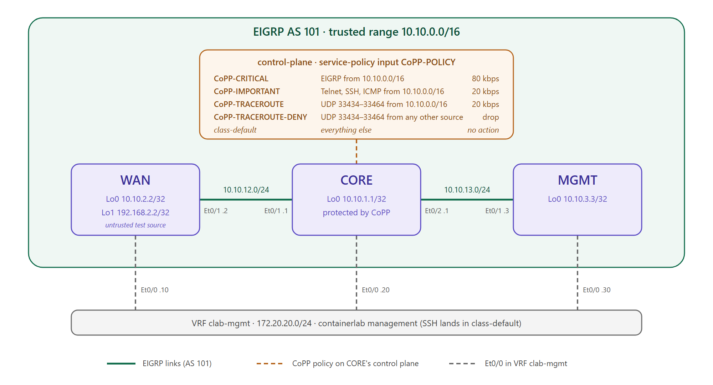
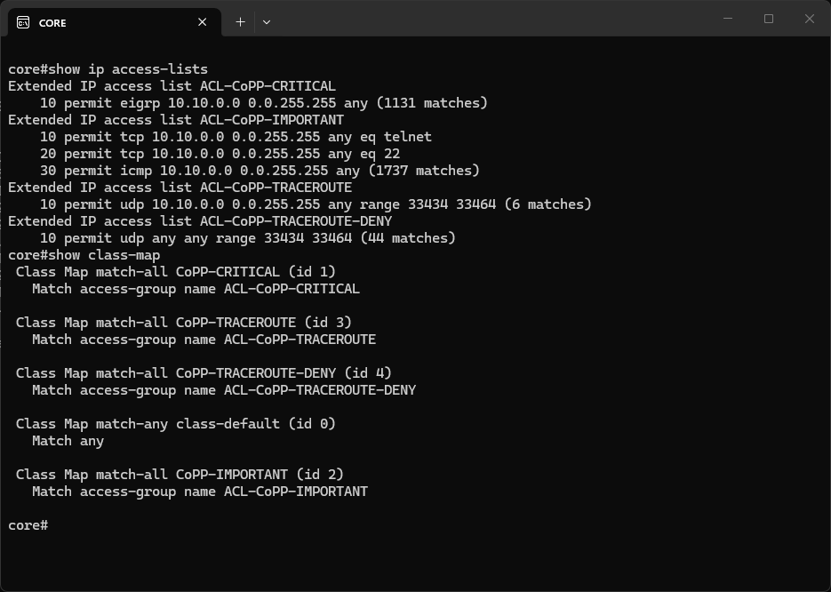
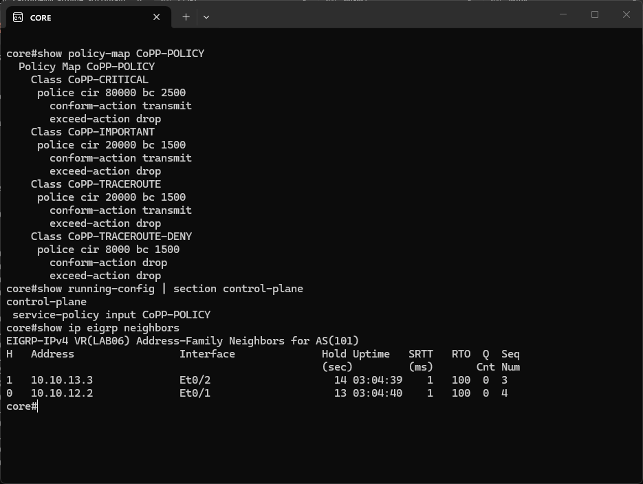
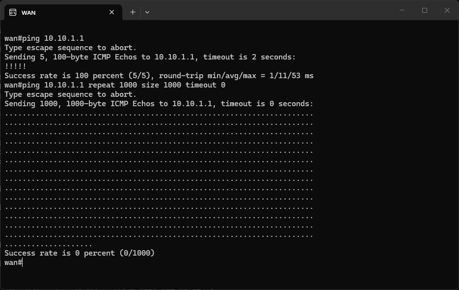
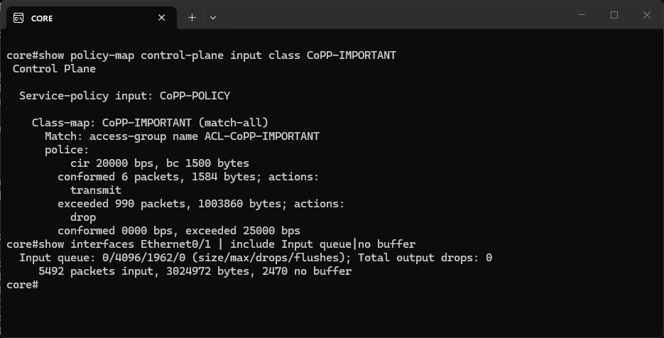
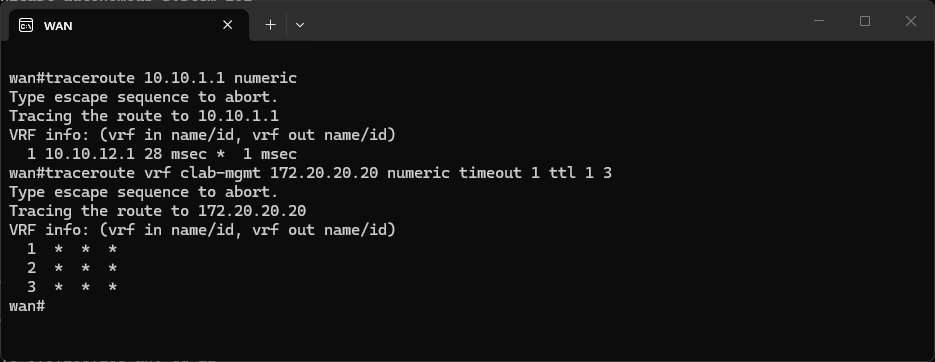
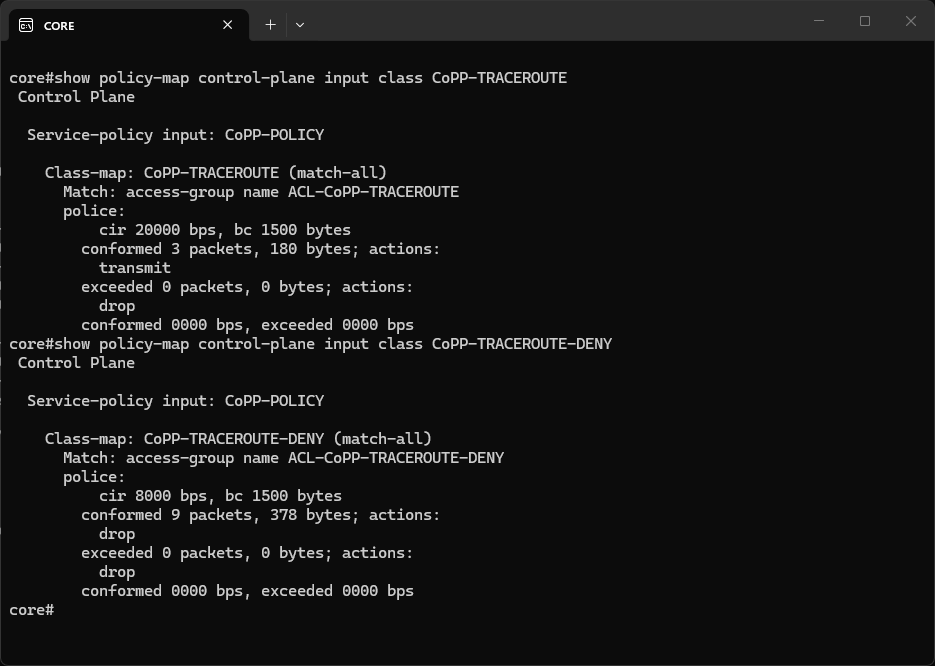
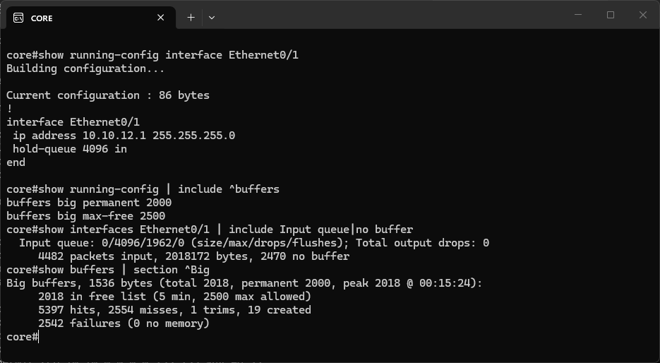

# CoPP Lab

## Credits

This lab is based on "LAB06 - CoPP" from the ENARSI Hands-On v1.0 course material
by [Magnetico Associazione Culturale](https://www.magnetico.cloud/).

## Topology

A [containerlab](https://containerlab.dev/) topology with 3 Cisco IOL routers in a line: WAN, CORE and MGMT, connected by two /24 transit links and running named-mode EIGRP (AS 101) on everything in 10.10.0.0/16. The routing is just the backdrop. The goal of the lab is to protect CORE's CPU with **Control Plane Policing (CoPP)**: a QoS policy applied to the traffic addressed to the router itself, which limits how much of each kind of traffic can reach the CPU.



- **WAN ↔ CORE**: 10.10.12.0/24 between WAN `Ethernet0/1` and CORE `Ethernet0/1`.
- **CORE ↔ MGMT**: 10.10.13.0/24 between CORE `Ethernet0/2` and MGMT `Ethernet0/1`.
- **Loopbacks**: one /32 per router in 10.10.x.x, advertised by EIGRP. WAN also has `Loopback1` 192.168.2.2/32, outside the trusted range and not advertised, which was used as an untrusted source during the tests (see [Traceroute only from 10.10.0.0/16](#traceroute-only-from-1010000016)).

| Config file | Hostname | Role | Loopback0 | Transit addresses | Mgmt IP |
|---|---|---|---|---|---|
| `configs/wan.cfg` | wan | edge router, traffic source for the tests | 10.10.2.2/32 | Et0/1 10.10.12.2/24 | 172.20.20.10 |
| `configs/core.cfg` | core | the router protected by CoPP | 10.10.1.1/32 | Et0/1 10.10.12.1/24, Et0/2 10.10.13.1/24 | 172.20.20.20 |
| `configs/mgmt.cfg` | mgmt | management side router | 10.10.3.3/32 | Et0/1 10.10.13.3/24 | 172.20.20.30 |

containerlab's `ethN` maps to IOL's `Ethernet0/N`. `Ethernet0/0` is always the management interface, in the `clab-mgmt` VRF.

In the original exercise each router loads its starting configuration with `configure replace tftp://...`. Here the same starting point is loaded as the containerlab `startup-config`, and the files in `configs/` contain the finished lab.

## Fixing the EIGRP adjacencies

The starting configuration has a fault to troubleshoot. On CORE, EIGRP made every interface passive and re-enabled only `Ethernet0/1`:

```
! CORE, starting configuration
router eigrp LAB06
 address-family ipv4 unicast autonomous-system 101
  af-interface default
   passive-interface
  exit-af-interface
  af-interface Ethernet0/1
   no passive-interface
  exit-af-interface
  network 10.10.0.0 0.0.255.255
```

A passive interface doesn't send or process hellos, so CORE formed the adjacency with WAN on `Ethernet0/1` but never with MGMT on `Ethernet0/2`. Its network was still advertised, but MGMT was cut off. Removing the two `af-interface` blocks makes all of CORE's interfaces in 10.10.0.0/16 active again.

WAN has the same `passive-interface` default with `no passive-interface` on `Ethernet0/1`, and that's correct there: WAN has a single neighbor, behind `Ethernet0/1`. Its loopbacks are passive, but `Loopback0` is still advertised. The `show ip eigrp neighbors` output in [The policy and the control plane](#the-policy-and-the-control-plane) shows CORE with both neighbors up.

## What CoPP protects

A router handles packets on two different paths. Transit traffic is forwarded by CEF without involving the CPU (the data plane). Traffic addressed to the router itself goes up to the CPU (the control plane): EIGRP hellos and updates, SSH and Telnet sessions, pings to its interfaces, traceroute probes. The CPU has limited resources, so a flood of pings or SSH SYNs is enough to starve the routing process. The EIGRP hellos stop being processed, the adjacencies drop, and the network loses its routes even though no transit traffic was involved.

CoPP uses the normal QoS framework (MQC) for this purpose: ACLs and class-maps to classify, a policy-map with `police` actions to limit each class, and the policy applied to the logical `control-plane` interface. The task asks for this on CORE, for inbound traffic:

| Class | Traffic | Allowed sources | Policing |
|---|---|---|---|
| `CoPP-CRITICAL` | dynamic routing (EIGRP) | 10.10.0.0/16 | 80 kbps |
| `CoPP-IMPORTANT` | Telnet, SSH, ping | 10.10.0.0/16 | 20 kbps |
| `CoPP-TRACEROUTE` | traceroute (UDP 33434–33464) to the router | **only** 10.10.0.0/16 | 20 kbps |

IOS/IOS-XE routers don't ship with a CoPP policy (the `control-plane` section is empty), unlike Catalyst 9000 (`system-cpp-policy`) and NX-OS, which apply one by default.

## Classifying the traffic

Each class starts from an extended ACL:

```
! CORE
ip access-list extended ACL-CoPP-CRITICAL
 permit eigrp 10.10.0.0 0.0.255.255 any
ip access-list extended ACL-CoPP-IMPORTANT
 permit tcp 10.10.0.0 0.0.255.255 any eq telnet
 permit tcp 10.10.0.0 0.0.255.255 any eq 22
 permit icmp 10.10.0.0 0.0.255.255 any
ip access-list extended ACL-CoPP-TRACEROUTE
 permit udp 10.10.0.0 0.0.255.255 any range 33434 33464
ip access-list extended ACL-CoPP-TRACEROUTE-DENY
 permit udp any any range 33434 33464
!
class-map match-all CoPP-CRITICAL
 match access-group name ACL-CoPP-CRITICAL
class-map match-all CoPP-IMPORTANT
 match access-group name ACL-CoPP-IMPORTANT
class-map match-all CoPP-TRACEROUTE
 match access-group name ACL-CoPP-TRACEROUTE
class-map match-all CoPP-TRACEROUTE-DENY
 match access-group name ACL-CoPP-TRACEROUTE-DENY
```

An ACL referenced by a `match` doesn't filter anything. `permit` only means "this packet belongs to the class", while `deny` (or no match) means "try the next class". What happens to the packet is decided later, by the policy-map. This is the same logic as an ACL inside a route-map, and the opposite of an ACL applied with `ip access-group`, where `deny` really drops. The trap is writing `deny` in `ACL-CoPP-TRACEROUTE-DENY`: the class would never match and the traffic would slip through.

A few details of the ACLs:

- The destination is always `any`: everything that reaches the control plane is addressed to the router by definition, so there's no need to list CORE's addresses.
- `eigrp` is IP protocol 88 and covers hellos, updates and queries, multicast to 224.0.0.10 or unicast.
- `icmp` without a type matches every ICMP message, so both pings *to* CORE (echo requests) and the replies to pings *from* CORE (echo replies) are in the class.
- A port range needs `range`. An ACL entry takes a single operator per port, so `gt 33433 lt 33465` is rejected, and two separate `gt`/`lt` entries would be ORed together and match every port.
- The PDF names only the first two classes. The traceroute ones are named here `CoPP-TRACEROUTE` and `CoPP-TRACEROUTE-DENY`. The second one exists because the task allows traceroute **exclusively** from 10.10.0.0/16: without it, traceroute from other sources would match no class and pass unpoliced (see below).
- ACL and class-map names are case-sensitive. A `match access-group name` pointing to a non-existent ACL is accepted without errors and simply never matches.

The `matches` counters in `show ip access-lists` grow even though the ACLs aren't applied to an interface: here they count the classification hits from CoPP. `show class-map` also lists `class-default`, which always exists and matches everything (`match any`):



## The policy and the control plane

The policy-map gives each class its action, and `service-policy input` attaches it to the control plane:

```
! CORE
policy-map CoPP-POLICY
 class CoPP-CRITICAL
  police 80000 conform-action transmit exceed-action drop
 class CoPP-IMPORTANT
  police 20000 conform-action transmit exceed-action drop
 class CoPP-TRACEROUTE
  police 20000 conform-action transmit exceed-action drop
 class CoPP-TRACEROUTE-DENY
  police 8000 conform-action drop exceed-action drop
!
control-plane
 service-policy input CoPP-POLICY
```

- `police <bps>` is a single-rate policer: traffic within the rate is `conform` and is transmitted, traffic above it is `exceed` and is dropped. There's no buffering, unlike shaping: the excess is discarded before it reaches the CPU.
- The classes are evaluated **top-down, first match**. `CoPP-TRACEROUTE` must come before `CoPP-TRACEROUTE-DENY`, otherwise the catch-all class would also drop the trusted traceroute.
- This IOL image has no `drop` action under a policy-map class. The equivalent is a policer that drops in both states. 8000 bps is the lowest rate the router accepts, and the value is irrelevant anyway, since every packet is dropped.
- `class-default` has no action, so whatever isn't classified passes **unpoliced**. This is the opposite of a route-map, whose implicit deny drops whatever doesn't match. It also means that SSH, Telnet or ping from outside 10.10.0.0/16 aren't limited at all, because they fall into `class-default`. The task only restricts the source for traceroute, so the lab sticks to it. In production `class-default` would get a low `police` too, together with an explicit class for the out-of-band management. In this lab CoPP doesn't touch the containerlab SSH sessions from 172.20.20.0/24 because they're in `class-default`.

`show policy-map CoPP-POLICY` shows the `bc` (committed burst, in bytes) next to each CIR, even though it was never configured. IOS computes it as `CIR / 32` (a quarter of a second of traffic at the CIR, converted to bytes), with a minimum of 1500 bytes so that at least one full-size packet fits: 80000 / 32 = **2500** for `CoPP-CRITICAL`, while 20000 / 32 = 625 and 8000 / 32 = 250 are raised to **1500**. The policy is attached to the control plane, and the EIGRP adjacencies with WAN (10.10.12.2) and MGMT (10.10.13.3) stay up, with uptime unaffected:



## Policing in action: a ping flood

To see the policer at work, WAN pings CORE's loopback twice. First a normal ping, then a flood of 1000 echo requests of 1000 bytes with `timeout 0`. With a zero timeout the router sends the next echo without waiting for the reply, so the flood goes far above 20 kbps. It also means every packet is printed as `.`, so the `0 percent` success rate tells nothing about CoPP: the normal ping just before it gets `!!!!!`, because 5 small packets stay well within the rate:



On CORE (counters cleared with `clear control-plane *` before the test), `CoPP-IMPORTANT` reports **6 packets conformed**: the 5 echoes of the normal ping (5 × 114 bytes on the wire) plus a single 1014-byte packet of the flood, for 1584 bytes. The 1500-byte burst lets one big packet through, and after that the bucket refills at only 2500 bytes per second while the flood keeps arriving. The other **990** packets of the flood are `exceeded` and dropped. The interface counters show that the flood really reached the policer: the input queue drops (`1962`) and `no buffer` drops (`2470`) are the same values as before the test. The next section explains where those numbers come from.



## Traceroute only from 10.10.0.0/16

For the trusted source, WAN runs a plain traceroute to 10.10.1.1, sourced from its `Ethernet0/1` address 10.10.12.2. For the untrusted source, the test has to come from an address outside 10.10.0.0/16 **and** CORE must be able to answer it. Otherwise a `* * *` would prove nothing, since it could be caused by a missing return route instead of CoPP. WAN's `Loopback1` (192.168.2.2) doesn't satisfy the second condition: with `traceroute 10.10.1.1 source Loopback1` the probes reach CORE (the path is chosen by the destination, the source only fills the header), but CORE has no route back to 192.168.2.2, so without CoPP the probes would get no answer either. The management VRF does satisfy both: 172.20.20.0/24 is a connected network on both routers, so `traceroute vrf clab-mgmt 172.20.20.20` would get an answer from CORE without CoPP.

CoPP is applied to the control plane, not to an interface. It catches traffic for the CPU from every interface and every VRF, including probes that arrive on `Ethernet0/0` in `clab-mgmt`. The trusted traceroute gets answered by 10.10.12.1, while the one from 172.20.20.10 only gets `* * *`:



The middle `*` of the trusted traceroute isn't caused by CoPP. On CORE the 3 probes are all `conformed` and transmitted. CORE answers each probe with an ICMP port unreachable, and IOS rate-limits unreachables to one every 500 ms by default (`ip icmp rate-limit unreachable`), so the second answer is suppressed. The 9 probes of the untrusted traceroute (3 hops × 3 probes) are in `CoPP-TRACEROUTE-DENY`. They show up as `conformed` because they stay below 8 kbps, but in this class the conform action is `drop` too. The counter only says whether a packet was within the rate. Its fate is decided by the action:



A side effect of the task: nobody outside 10.10.0.0/16 can traceroute to CORE any more, the containerlab host and the management network included.

## IOL: what sits in front of CoPP

The first ping floods didn't show up in the CoPP counters as expected. Out of 2000 echo requests sent by WAN, `CoPP-IMPORTANT` counted only 162 (12 conformed, 150 exceeded). The others never reached the policer, because in IOL every packet for the CPU has to go through two other resources first:

```
packet ─► [1] free buffer? ─► [2] room in the input queue? ─► [3] CoPP ─► CPU
            no → "no buffer"     no → "Input queue ... drops"    police
```

1. **Input queue (hold queue).** Packets for the CPU wait in the interface's input queue, which by default holds **75** packets. A burst sent with `timeout 0` fills it immediately and the rest is tail-dropped. That was the first test: 1838 drops in `Input queue: 0/75/1838/0`, and 1838 + 162 = 2000.
2. **Buffer pool.** With the queue enlarged to 4096 packets (`hold-queue 4096 in`), the bottleneck moved. To be received, a packet needs a free system buffer of the right size, and the 1000-byte pings use the **Big buffers** (1536 bytes), of which IOL keeps only 90. IOS creates more on demand, but too slowly for a burst: the pool peaked at 108, the interface counted `2470 no buffer`, and `show buffers` reported `2542 failures` for the Big pool. CoPP saw 494 packets (3 conformed, 491 exceeded).
3. With **2000 permanent Big buffers**, the whole flood finally reaches CoPP. In the first run, `CoPP-IMPORTANT` counted 1 packet conformed and 998 exceeded out of 1000.

These settings are kept in `configs/core.cfg` so that the flood test shows the policer only:

```
! CORE
buffers big permanent 2000
buffers big max-free 2500
!
interface Ethernet0/1
 hold-queue 4096 in
```

`permanent` is the number of buffers always allocated, and `max-free` the maximum number of free buffers IOS keeps before trimming the pool. It must be at least `permanent`. The drop counters in the screenshot are still the ones accumulated during the first tests (1962 input queue drops, 2470 `no buffer`). Since then they haven't moved, and the Big pool has 2018 buffers in its free list:



This is an artifact of IOL being entirely software. On hardware platforms (ISR 4000, ASR 1000, Catalyst 9000) CoPP is enforced in the forwarding hardware, **before** the punt path to the CPU, so the policer sees the whole flood without any tuning. The end result for the CPU is the same anyway: in every test only a few pings reached it, and EIGRP never dropped. These two settings aren't a good idea in production: a deeper queue means more memory and more latency for everything queued towards the CPU, EIGRP hellos included. They're here only to make the policer's behaviour readable in the lab.

## Running the lab

```bash
# deploy / destroy (from the copp directory)
clab deploy
clab destroy --cleanup
```

No host bridge is needed: the three routers are connected back to back. The nodes `wan`, `core` and `mgmt` are reachable via containerlab console/exec or SSH on 172.20.20.10, 172.20.20.20 and 172.20.20.30 (user `admin`). `scripts/lab_tools.py` can export the running configs back into `configs/` (`export-configs`) and open an SSH session to every router at once (`open-sessions`). To repeat a test from zero, clear the CoPP counters on CORE with `clear control-plane *`.
