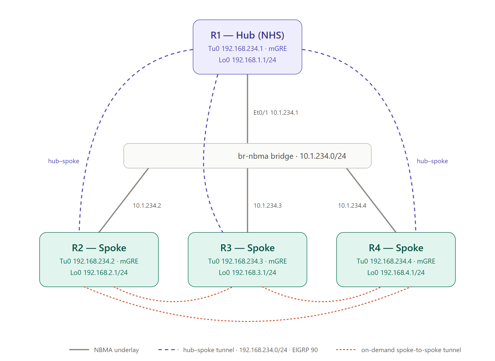
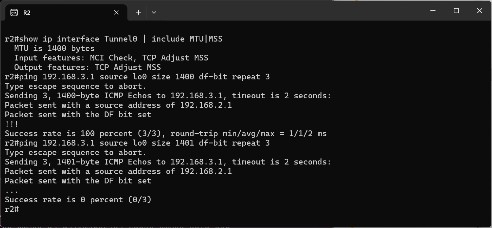
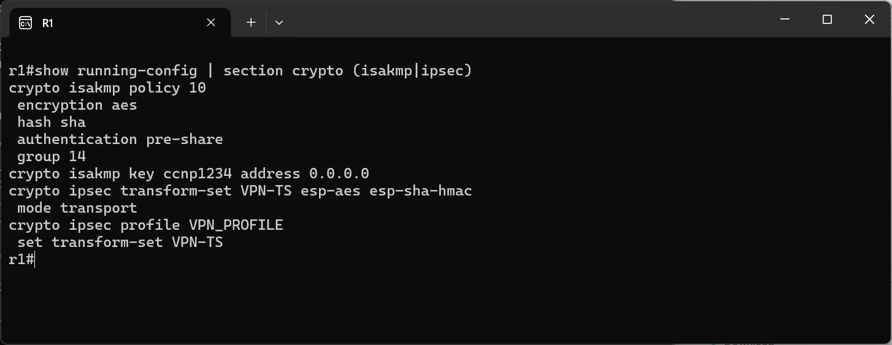
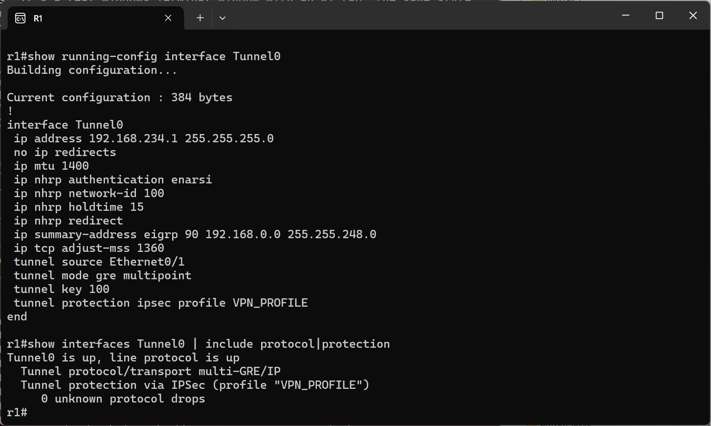
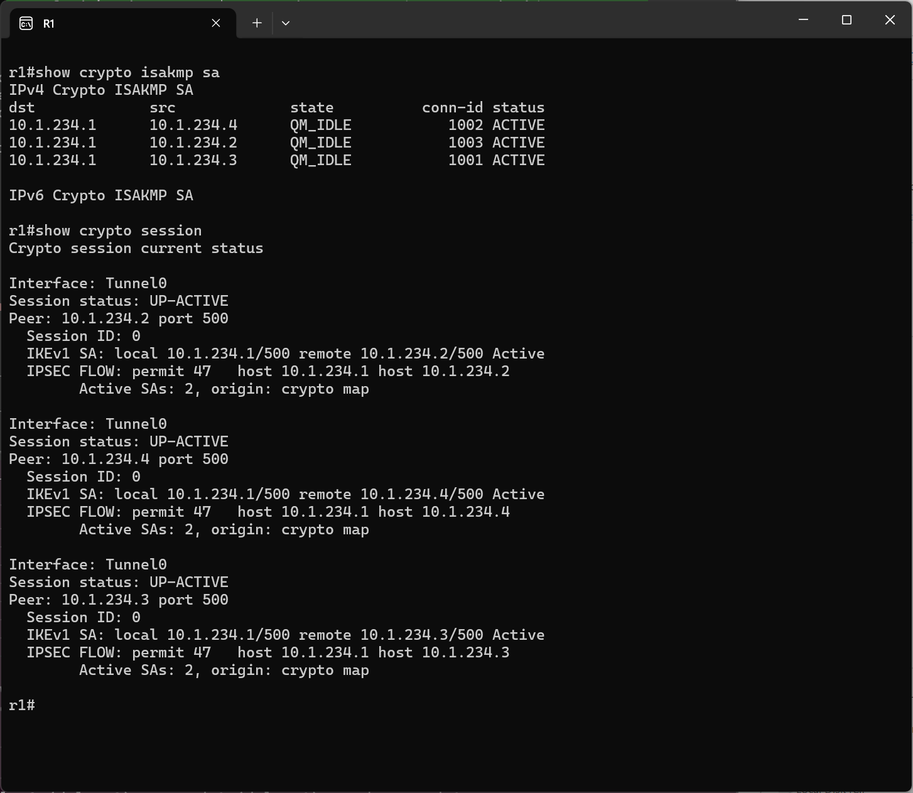
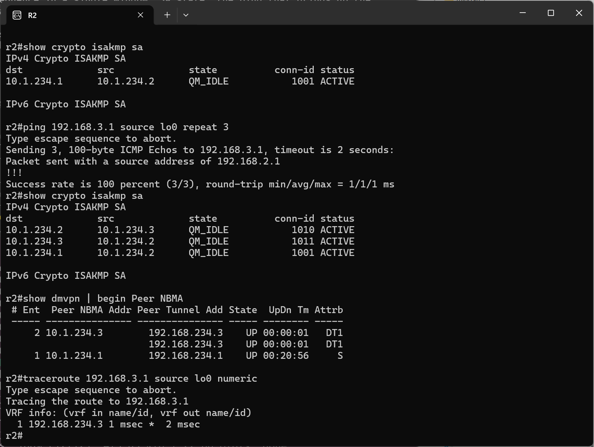

# DMVPN Tunnel Protection (IPsec) Lab

## Credits

This lab is based on "LAB03 - DMVPN tunnel protection" from the ENARSI Hands-On v1.0 course material
by [Magnetico Associazione Culturale](https://www.magnetico.cloud/).

## Topology

A [containerlab](https://containerlab.dev/) topology with 4 Cisco IOL routers that starts from the final state of the [DMVPN Phase 2 and Phase 3 lab](../dmvpn-p2-p3/): same hub (R1), same three mGRE spokes (R2–R4), EIGRP AS 90 and NHRP redirect/shortcut (Phase 3). Up to now the overlay was plain GRE, so everything crossing the NBMA network travelled in clear text. This lab adds two things to the tunnels:

- **MTU / MSS tuning** on the overlay, to leave room for the GRE and IPsec headers.
- **IPsec tunnel protection**, so that every GRE packet between two DMVPN routers is encrypted, both on the hub-spoke tunnels and on the on-demand spoke-to-spoke ones.



- **Underlay (NBMA)**: all four routers share a single segment, 10.1.234.0/24, through a containerlab bridge (`br-nbma`). The tunnel endpoints (NBMA addresses) and the IPsec peers live here.
- **Overlay (DMVPN)**: the tunnel network 192.168.234.0/24, mGRE on every router. R1 is the hub and Next Hop Server (NHS).
- **Routing**: EIGRP AS 90 on the tunnel and loopback interfaces. The hub advertises the summary 192.168.0.0/21, and the spokes build shortcuts to each other through NHRP.
- **Security**: IKEv1 with pre-shared key and an IPsec profile applied to Tunnel0 on every router.

| Config file | Hostname | Role | Et0/1 (NBMA) | Tunnel0 | Loopback0 | Mgmt IP |
|---|---|---|---|---|---|---|
| `configs/r1.cfg` | R1 | Hub / NHS | 10.1.234.1/24 | 192.168.234.1/24 (mGRE + IPsec) | 192.168.1.1/24 | 172.20.20.10 |
| `configs/r2.cfg` | R2 | Spoke | 10.1.234.2/24 | 192.168.234.2/24 (mGRE + IPsec) | 192.168.2.1/24 | 172.20.20.20 |
| `configs/r3.cfg` | R3 | Spoke | 10.1.234.3/24 | 192.168.234.3/24 (mGRE + IPsec) | 192.168.3.1/24 | 172.20.20.30 |
| `configs/r4.cfg` | R4 | Spoke | 10.1.234.4/24 | 192.168.234.4/24 (mGRE + IPsec) | 192.168.4.1/24 | 172.20.20.40 |

containerlab's `ethN` maps to IOL's `Ethernet0/N`. `Ethernet0/0` is always the management interface (in the `clab-mgmt` VRF).

## MTU and MSS on the overlay

Every packet that enters Tunnel0 gets wrapped in more headers before it reaches the NBMA network: 24 bytes of GRE (new IP header plus GRE header with the tunnel key), and on top of that the ESP header, IV, padding and authentication trailer added by IPsec. A 1500-byte packet from the LAN would no longer fit in the 1500-byte underlay and would have to be fragmented after encryption, which is expensive and often breaks applications.

The usual fix is to lower the IP MTU of the tunnel to 1400 bytes, leaving plenty of room for the overhead, and to clamp the TCP MSS to 1360 bytes (1400 minus 20 bytes of IP and 20 of TCP header). The MSS clamp rewrites the SYN packets crossing the tunnel, so TCP sessions agree from the start on segments that fit and never rely on fragmentation or Path MTU Discovery:

```
! R1, R2, R3, R4
interface Tunnel0
 ip mtu 1400
 ip tcp adjust-mss 1360
```

On R2, `show ip interface Tunnel0` reports `MTU is 1400 bytes` and `TCP Adjust MSS` among the input and output features. A ping toward R3's LAN with the DF bit set shows where the limit is: 1400-byte packets go through, while 1401-byte packets can't be sent through the tunnel without fragmentation, so they fail:



## The IPsec profile

The protection is defined in three blocks, identical on every router:

```
! R1, R2, R3, R4
crypto isakmp policy 10
 encryption aes
 hash sha
 authentication pre-share
 group 14
crypto isakmp key ccnp1234 address 0.0.0.0
!
crypto ipsec transform-set VPN-TS esp-aes esp-sha-hmac
 mode transport
!
crypto ipsec profile VPN_PROFILE
 set transform-set VPN-TS
```

- **ISAKMP (IKE phase 1)**: AES encryption, SHA hash and authentication with the pre-shared key `ccnp1234`. The key is bound to `address 0.0.0.0`, a wildcard: in a DMVPN the spokes can build SAs with each other on demand, so every router must be ready to authenticate any peer on the NBMA network, not just a fixed list. The exercise asks for **DH group 5**, but IOS-XE 17.18 deprecates it, so the lab uses **group 14** (2048-bit) instead.
- **Transform set (IKE phase 2)**: ESP with AES and SHA-HMAC, in **transport mode**. GRE already provides a new outer IP header between the two NBMA addresses, so there's no point in letting IPsec add yet another one (tunnel mode). In transport mode ESP is inserted between the GRE packet's IP header and the GRE header, which saves 20 bytes per packet.
- **IPsec profile**: instead of a crypto map with static peers and ACLs, the profile only lists the transform set. Peers and traffic are derived from the tunnel interface it's attached to.



## Tunnel protection on Tunnel0

The profile is applied with a single line on the tunnel interface:

```
! R1, R2, R3, R4
interface Tunnel0
 tunnel protection ipsec profile VPN_PROFILE
```

From now on the router encrypts every GRE packet that leaves Tunnel0 and expects every GRE packet arriving on it to be encrypted. The peer for each SA is the NBMA address that NHRP has resolved for the destination, so IPsec automatically follows the DMVPN: hub-spoke SAs for the registrations and the EIGRP traffic, spoke-to-spoke SAs when a shortcut is built. `show interfaces Tunnel0` now shows `Tunnel protection via IPSec (profile "VPN_PROFILE")` next to the `multi-GRE/IP` transport:



## Hub-spoke SAs

As soon as the spokes register with the hub, each of them negotiates an SA with R1. On the hub, `show crypto isakmp sa` lists three IKE SAs, one per spoke, all in `QM_IDLE`: phase 1 is complete and quick mode (phase 2) has produced the IPsec SAs. `show crypto session` shows the same three peers as `UP-ACTIVE` on Tunnel0. The protected flow is `permit 47 host 10.1.234.1 host 10.1.234.X`, meaning IP protocol 47 (GRE) between the hub's and the spoke's NBMA addresses: IPsec encrypts the GRE packets, and with them everything carried inside (NHRP, EIGRP, user traffic). `Active SAs: 2` is one inbound and one outbound IPsec SA per peer. The `origin: crypto map` label comes from the fact that, internally, tunnel protection builds a dynamic crypto map from the profile:



## Spoke-to-spoke SAs on demand

The spoke-to-spoke tunnels of Phase 3 are protected too, and their SAs are created only when needed. Before any traffic between R2 and R3, R2 has a single IKE SA, with the hub. A ping from R2's LAN to R3's LAN first goes through the hub, which sends the NHRP redirect. R2 resolves R3's NBMA address with a shortcut, and before it can send GRE packets directly to 10.1.234.3 it negotiates an SA with R3.

Right after the ping, R2 has two new IKE SAs with R3 in `QM_IDLE`, one for each direction (10.1.234.3 → 10.1.234.2 and 10.1.234.2 → 10.1.234.3), because both spokes started the negotiation at the same time. `show dmvpn` shows the dynamic entries for R3 (`DT1`, the shortcut route installed), and the traceroute reaches 192.168.3.1 in a single hop, directly over the protected spoke-to-spoke tunnel:



As in the previous lab, the NHRP shortcut for 192.168.3.0/24 ages out quickly without traffic (`ip nhrp holdtime 15`), so the next flow goes through the hub again and triggers a new redirect. The IKE/IPsec SAs with R3, on the other hand, stay up until their lifetime expires or they are cleared (`clear crypto session remote 10.1.234.3`), so the new shortcut can reuse them without another negotiation.

## Running the lab

```bash
# create the NBMA bridge if missing (it's a host bridge, so it must exist before deploy)
./scripts/create_bridge.sh br-nbma

# deploy / destroy (from the dmvpn-ipsec directory)
clab deploy
clab destroy --cleanup
```

Nodes `r1`–`r4` are reachable via containerlab console/exec or SSH on 172.20.20.10–40 (user `admin`). `scripts/lab_tools.py` can export the running configs back into `configs/` (`export-configs`) and open an SSH session to every router at once (`open-sessions`).
