# DMVPN Phase 2 and Phase 3 Lab

## Credits

This lab is based on "LAB02 - DMVPN fase 2 e 3" from the ENARSI Hands-On v1.0 course material
by [Magnetico Associazione Culturale](https://www.magnetico.cloud/).

## Topology

A [containerlab](https://containerlab.dev/) topology with 4 Cisco IOL routers that picks up where the [DMVPN Phase 1 lab](../dmvpn-p1/) left off: same hub (R1), same three spokes (R2–R4), same underlay and EIGRP AS 90. This time the spokes get **multipoint GRE** tunnels too, so they can build tunnels directly to each other on demand. The lab goes through two steps:

- **Phase 2**: spoke-to-spoke tunnels driven by the routing table. The hub must advertise every spoke LAN with the *original* spoke as next hop, so EIGRP on the hub needs both split-horizon and next-hop-self disabled.
- **Phase 3**: spoke-to-spoke tunnels driven by NHRP. The hub only advertises a summary and sends **NHRP redirects**; the spokes answer with **NHRP shortcuts** that install more specific routes on their own.

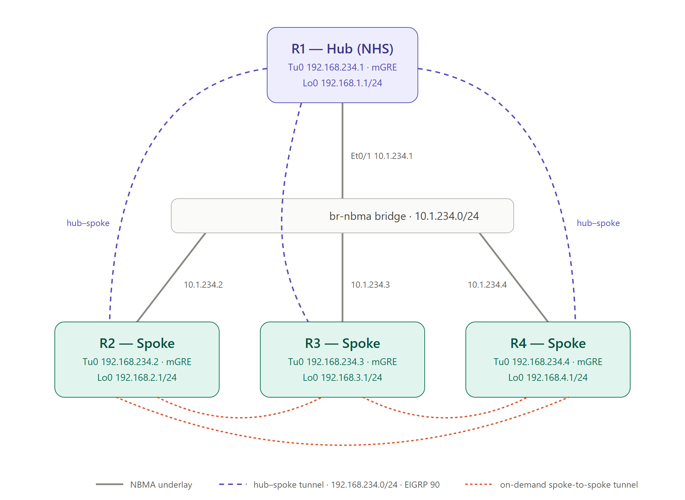

- **Underlay (NBMA)**: all four routers share a single segment, 10.1.234.0/24, through a containerlab bridge (`br-nbma`). The tunnel endpoints (NBMA addresses) live here.
- **Overlay (DMVPN)**: the tunnel network 192.168.234.0/24. R1 is the hub and Next Hop Server (NHS). R2, R3 and R4 are spokes, all with mGRE tunnels.
- **Routing**: EIGRP AS 90 on the tunnel and loopback interfaces. Loopback0 on each router stands in for the site LAN (192.168.X.0/24), and the spokes are `eigrp stub connected`.

| Config file | Hostname | Role | Et0/1 (NBMA) | Tunnel0 | Loopback0 | Mgmt IP |
|---|---|---|---|---|---|---|
| `configs/r1.cfg` | R1 | Hub / NHS | 10.1.234.1/24 | 192.168.234.1/24 (mGRE) | 192.168.1.1/24 | 172.20.20.10 |
| `configs/r2.cfg` | R2 | Spoke | 10.1.234.2/24 | 192.168.234.2/24 (mGRE) | 192.168.2.1/24 | 172.20.20.20 |
| `configs/r3.cfg` | R3 | Spoke | 10.1.234.3/24 | 192.168.234.3/24 (mGRE) | 192.168.3.1/24 | 172.20.20.30 |
| `configs/r4.cfg` | R4 | Spoke | 10.1.234.4/24 | 192.168.234.4/24 (mGRE) | 192.168.4.1/24 | 172.20.20.40 |

The files in `configs/` hold the **final (Phase 3)** configuration. The Phase 2 state is in commit `aff2293` ("config phase2"). containerlab's `ethN` maps to IOL's `Ethernet0/N`. `Ethernet0/0` is always the management interface (in the `clab-mgmt` VRF).

## Phase 2 — spoke-to-spoke tunnels

### Spokes: from p2p GRE to mGRE

In Phase 1, the spokes had a fixed `tunnel destination` pointing at the hub, so they couldn't send a GRE packet anywhere else. In Phase 2, that line is replaced by `tunnel mode gre multipoint`. The GRE destination of each packet is now looked up in the NHRP table, exactly as on the hub.

Without a fixed destination, the spoke no longer knows the hub's NBMA address implicitly, so the NHS statement now carries it explicitly. `nbma 10.1.234.1` creates the static tunnel-to-NBMA mapping for the hub (the `S` entry in `show dmvpn`), and `multicast` sends broadcast/multicast traffic (the EIGRP hellos) to the hub, which is what lets the EIGRP adjacency form over an mGRE interface:

```
! R2 (R3 and R4 are identical apart from the addresses)
interface Tunnel0
 ip address 192.168.234.2 255.255.255.0
 no ip redirects
 ip nhrp authentication enarsi
 ip nhrp network-id 100
 ip nhrp holdtime 15
 ip nhrp nhs 192.168.234.1 nbma 10.1.234.1 multicast
 tunnel source Ethernet0/1
 tunnel mode gre multipoint
 tunnel key 100
```

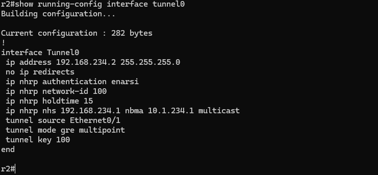

### Hub: split-horizon and next-hop-self

The lab's starting configuration has the problem already covered in Phase 1. With split-horizon active on the hub's Tunnel0, R1 doesn't re-advertise the routes it learns from one spoke to the other spokes, so R2–R4 never see each other's LANs. The first fix is the same as before: `no ip split-horizon eigrp 90`.

In Phase 2 that's no longer enough. By default, EIGRP sets itself as the next hop when it advertises a route. So R2 does learn 192.168.3.0/24 and 192.168.4.0/24, but **via 192.168.234.1**, the hub, and traffic keeps flowing through R1 exactly as in Phase 1. mGRE on the spokes alone gains nothing:

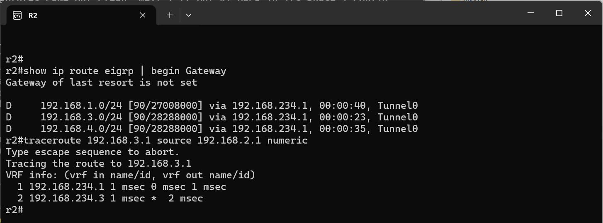

The answer to the lab's question ("are further changes to R1's EIGRP process needed?") is therefore yes: the hub must stop rewriting the next hop, so it passes the original spoke's tunnel address along unchanged:

```
! R1
interface Tunnel0
 ip address 192.168.234.1 255.255.255.0
 no ip redirects
 no ip next-hop-self eigrp 90
 no ip split-horizon eigrp 90
 ip nhrp authentication enarsi
 ip nhrp network-id 100
 ip nhrp holdtime 15
 tunnel source Ethernet0/1
 tunnel mode gre multipoint
 tunnel key 100
```

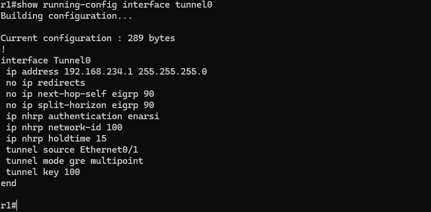

### Verification

R2 now sees each remote LAN with the **remote spoke** as next hop (192.168.3.0/24 via 192.168.234.3, 192.168.4.0/24 via 192.168.234.4). R2 still has no NBMA address for 192.168.234.3, so the first packets trigger an NHRP Resolution Request to the NHS, and in the meantime they are forwarded through the hub. That's why the first traceroute still shows two hops. Once R3 has answered, the spoke-to-spoke tunnel is up and the second traceroute reaches R3 in a single hop:

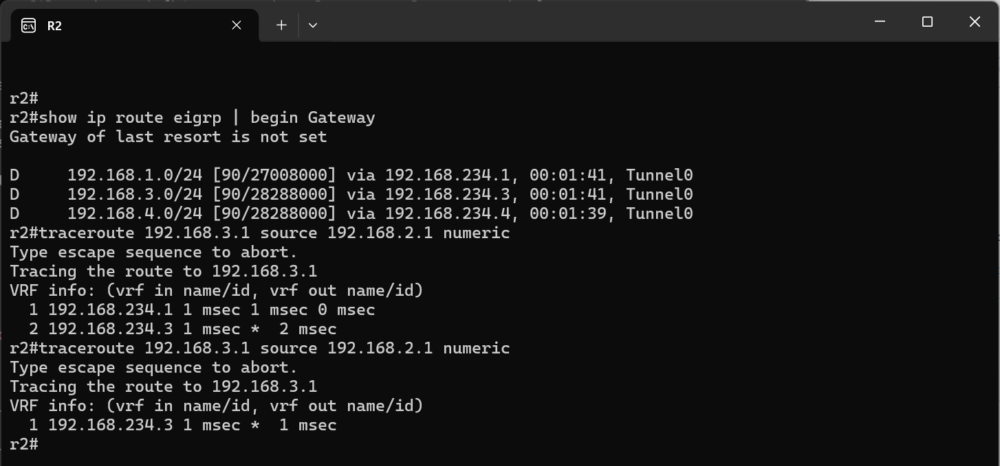

`show dmvpn` on R2 now lists two peers: the hub (static, `S`) and R3 (dynamic, `D`, created a few seconds earlier by the resolution). In `show ip nhrp`, the new entry is a `/32` for R3's **tunnel address**, the next hop of the EIGRP route, with the `nhop` flag. In Phase 2, NHRP only resolves next hops; the forwarding decision still comes entirely from the routing table:

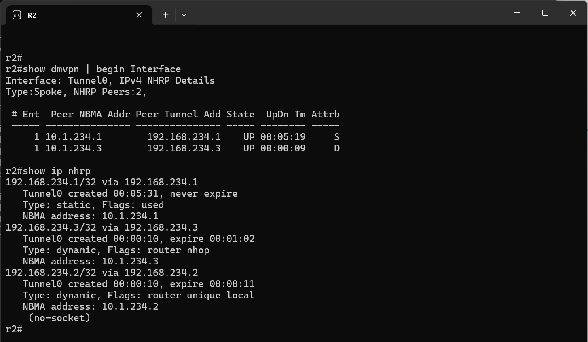

The weakness of Phase 2 is that it relies on every spoke having **every specific route** with the right next hop. It can't use summarization or a default route from the hub, because the next hop would then be the hub again and no direct tunnel would ever be built. That doesn't scale with many spokes.

## Phase 3 — NHRP redirect and shortcut

### Hub: redirect plus summary

Phase 3 moves the spoke-to-spoke decision from routing to NHRP. On the hub:

- `ip nhrp redirect`: when R1 receives a packet on Tunnel0 and forwards it back out of Tunnel0 (spoke → hub → spoke), it sends the source spoke an **NHRP Traffic Indication** (redirect), meaning "there's a better path for this destination".
- `ip summary-address eigrp 90 192.168.0.0 255.255.248.0`: R1 advertises out of Tunnel0 only the summary 192.168.0.0/21 (192.168.0.0–192.168.7.255, which covers all four LANs) instead of the individual /24s. The lab text suggests a 192.168.0.0/16. The /21 used here is tighter, still covers every site, and leaves the tunnel network 192.168.234.0/24 outside the summary.

The Phase 2 EIGRP tweaks are **no longer needed** and have been removed. The summary is generated by R1 itself, not learned on Tu0, so split-horizon doesn't block it. And the next hop being the hub is now exactly what we want: the first packet goes to the hub, and the redirect does the rest.

```
! R1
interface Tunnel0
 ip address 192.168.234.1 255.255.255.0
 no ip redirects
 ip nhrp authentication enarsi
 ip nhrp network-id 100
 ip nhrp holdtime 15
 ip nhrp redirect
 ip summary-address eigrp 90 192.168.0.0 255.255.248.0
 tunnel source Ethernet0/1
 tunnel mode gre multipoint
 tunnel key 100
```

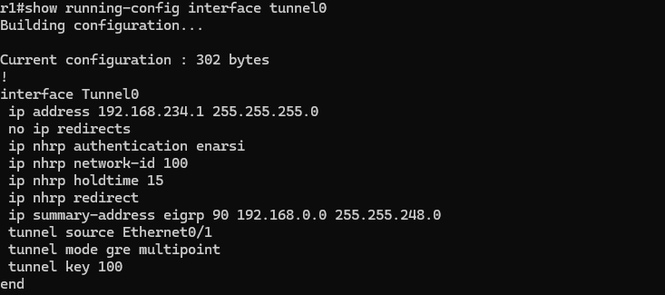

### Spokes: NHRP shortcut

The spoke side of Phase 3 is `ip nhrp shortcut`. On IOS-XE 17.x it's **enabled by default** on tunnel interfaces, so it doesn't appear in the running-config (`show running-config all | include nhrp shortcut` shows it) and the spokes' Tunnel0 is identical to Phase 2:

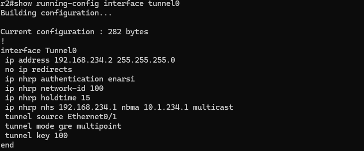

With the summary in place, the routing table of a spoke has shrunk to a single EIGRP route, 192.168.0.0/21 via the hub. Before any spoke-to-spoke traffic, the only NHRP peer is the hub:

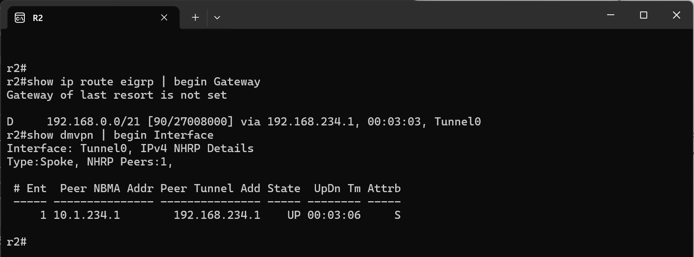

### Verification: two traceroutes

As the lab asks, here is a traceroute from R2 to 192.168.3.1 sourced from 192.168.2.1, run twice:

1. **First traceroute**: R2 matches the summary and sends the packet to the hub. R1 forwards it to R3 out of the same Tunnel0 and, because of `ip nhrp redirect`, sends R2 a Traffic Indication. R2 then sends an NHRP Resolution Request for 192.168.3.1, which travels through the hub to R3. R3 answers **directly** to R2 with its whole LAN prefix, 192.168.3.0/24, at NBMA 10.1.234.3. The trace shows two hops: 192.168.234.1, then 192.168.234.3.
2. **Second traceroute**: the shortcut is in place, so the packet goes straight from R2 to R3. That's one hop.

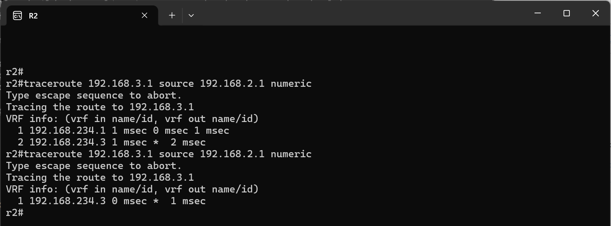

### What the shortcut added

After the traceroutes, the NHRP table and the routing table of R2 show what the shortcut created:

- In `show ip nhrp`, there's a new entry for the **network** 192.168.3.0/24 via 192.168.234.3 (NBMA 10.1.234.3), flagged `rib`, plus a `/32` for R3's tunnel address (`nhop rib`). The 192.168.2.0/24 `local` entry is R2's own prefix, as it was advertised to R3 in the resolution exchange.
- In `show ip route`, two **NHRP routes** (code `H`, AD 250) appear: 192.168.3.0/24 via 192.168.234.3 and 192.168.234.3/32. They are more specific than the EIGRP summary, so longest match sends 192.168.3.0/24 traffic directly to R3 while everything else still follows the summary to the hub.

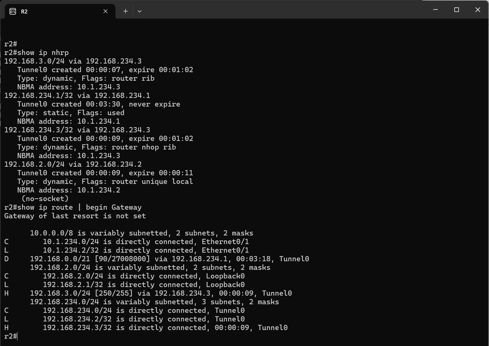

The difference from Phase 2 is that in Phase 2 NHRP only resolved the **next hop** (a /32 tunnel address) of a route that EIGRP had already installed with the right next hop. In Phase 3, EIGRP only knows the summary via the hub, and it's **NHRP** that learns the destination prefix and installs the specific route in the RIB. The spokes carry just one route plus the shortcuts actually in use, which time out when the traffic stops.

## Running the lab

```bash
# create the NBMA bridge if missing (it's a host bridge, so it must exist before deploy)
./scripts/create_bridge.sh br-nbma

# deploy / destroy (from the dmvpn-p2-p3 directory)
clab deploy
clab destroy --cleanup
```

Nodes `r1`–`r4` are reachable via containerlab console/exec or SSH on 172.20.20.10–40 (user `admin`). `scripts/lab_tools.py` can export the running configs back into `configs/` (`export-configs`) and open an SSH session to every router at once (`open-sessions`).
