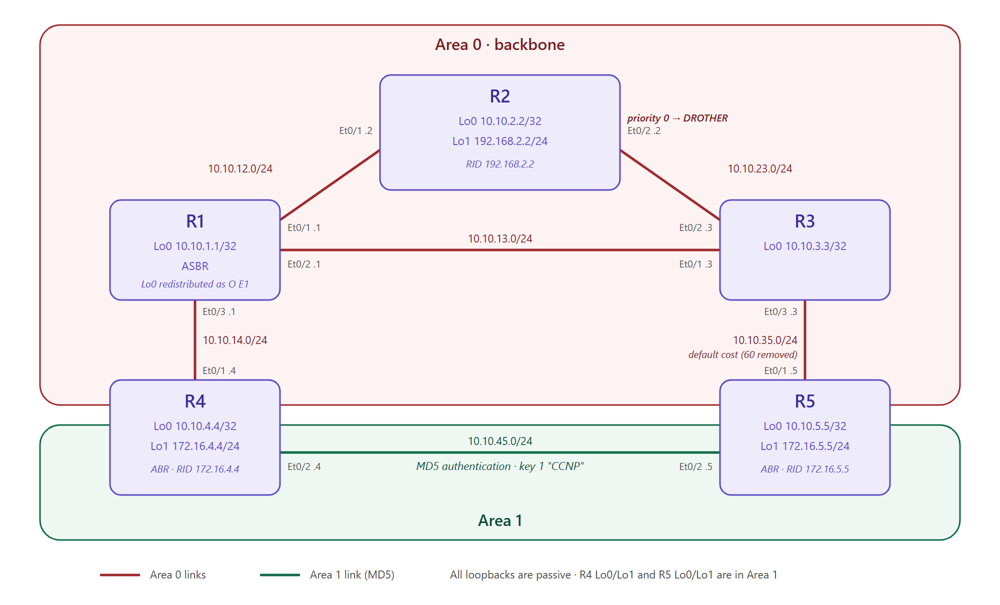
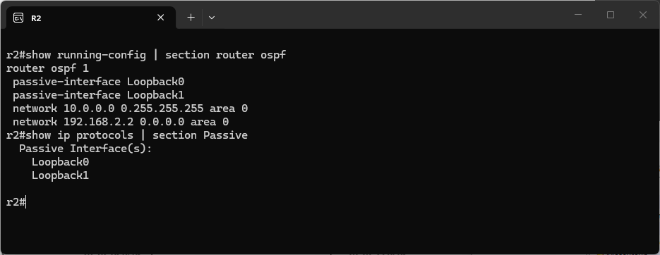
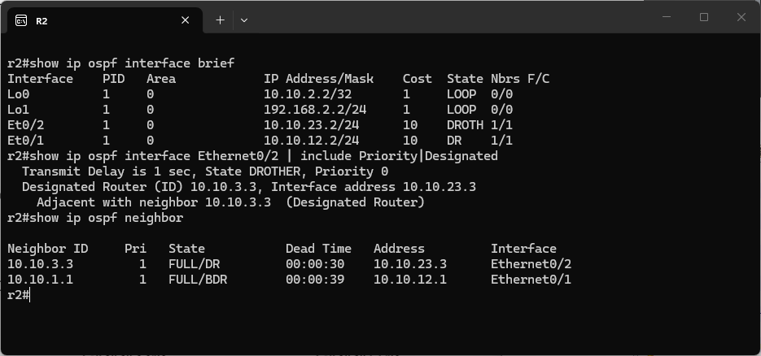
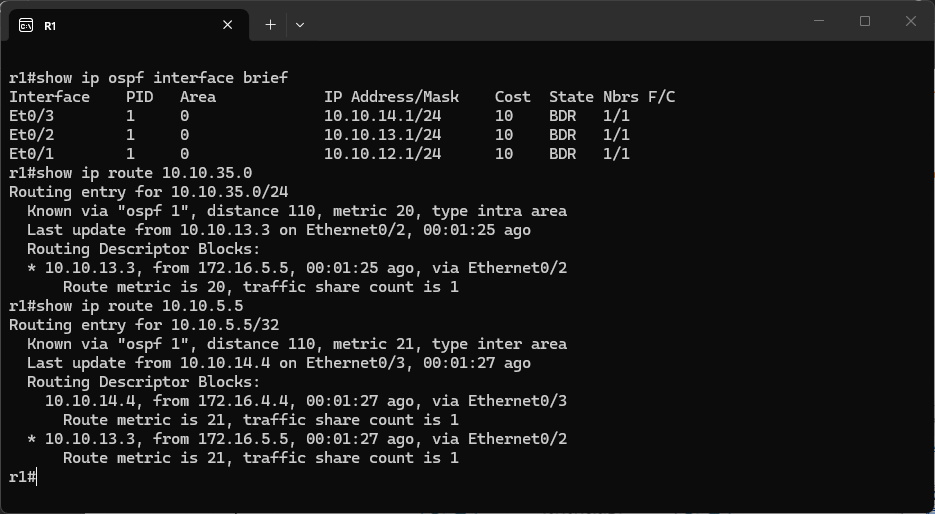
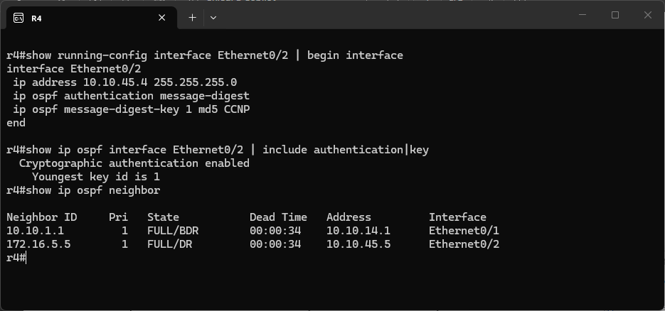
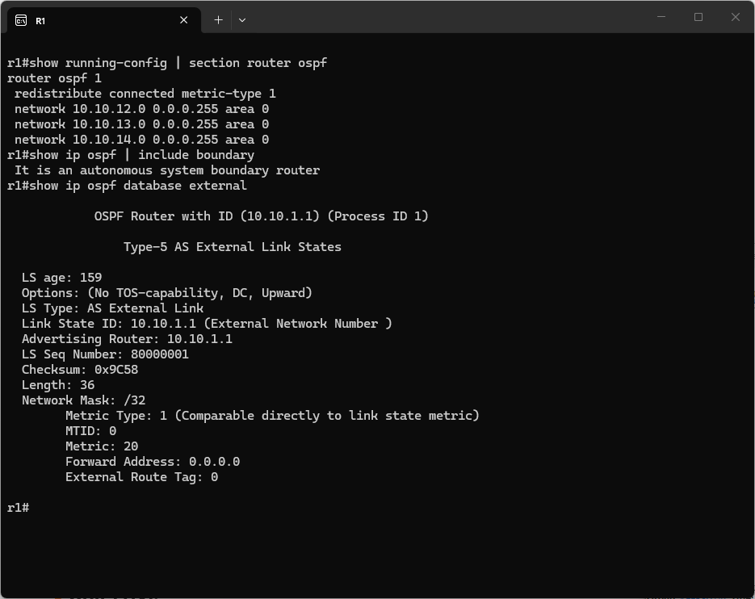
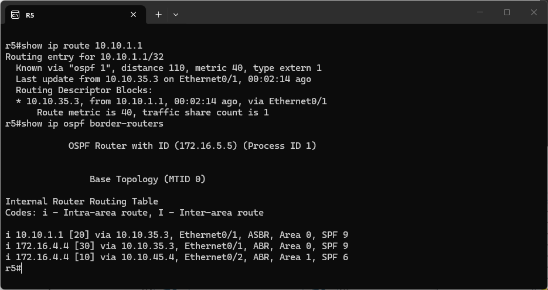

# OSPF Lab 07 — Tuning a Multi-Area OSPF Network

## Credits

This lab is based on "LAB07 - OSPF" from the ENARSI Hands-On v1.0 course material
by [Magnetico Associazione Culturale](https://www.magnetico.cloud/).

## Topology

A [containerlab](https://containerlab.dev/) topology with 5 Cisco IOL routers running OSPFv2 (`router ospf 1`) in two areas. Unlike the [OSPF lab](../ospf/README.md), which builds a multi-area design from scratch, this lab starts from a network that already works and asks to fine-tune it: make the loopbacks passive, control the DR/BDR election per segment, put back the default interface costs, authenticate the Area 1 adjacency with MD5, and advertise R1's Loopback0 as an external route whose metric grows along the path.



- **Area 0 (backbone)**: R1, R2 and R3 form a triangle. The links R1–R4 and R3–R5 are in Area 0 too.
- **Area 1**: the R4–R5 link plus the loopbacks of R4 and R5.
- **R4 and R5 are ABRs**: their uplink (Et0/1) is put in Area 0 with `ip ospf 1 area 0` on the interface, which takes precedence over the `network 10.0.0.0 0.255.255.255 area 1` statement covering everything else on the router.
- **No `router-id` is configured anywhere**, so each router takes the highest loopback address. That's why R2, R4 and R5 use their Loopback1 (192.168.2.2, 172.16.4.4, 172.16.5.5) and not Loopback0. R2 ending up with the highest RID in the lab matters for the DR election below.
- The `/24` Loopback1 addresses are advertised as `/32` host routes, the default for the OSPF `LOOPBACK` network type.

| Config file | Hostname | Role | Loopbacks | Router ID | Mgmt IP |
|---|---|---|---|---|---|
| `configs/r1.cfg` | r1 | Area 0, ASBR | Lo0 10.10.1.1/32 | 10.10.1.1 | 172.20.20.10 |
| `configs/r2.cfg` | r2 | Area 0 | Lo0 10.10.2.2/32, Lo1 192.168.2.2/24 | 192.168.2.2 | 172.20.20.20 |
| `configs/r3.cfg` | r3 | Area 0 | Lo0 10.10.3.3/32 | 10.10.3.3 | 172.20.20.30 |
| `configs/r4.cfg` | r4 | ABR (Area 0/1) | Lo0 10.10.4.4/32, Lo1 172.16.4.4/24 | 172.16.4.4 | 172.20.20.40 |
| `configs/r5.cfg` | r5 | ABR (Area 0/1) | Lo0 10.10.5.5/32, Lo1 172.16.5.5/24 | 172.16.5.5 | 172.20.20.50 |

| Link | Subnet | Area |
|---|---|---|
| R1 Et0/1 ↔ R2 Et0/1 | 10.10.12.0/24 | 0 |
| R1 Et0/2 ↔ R3 Et0/1 | 10.10.13.0/24 | 0 |
| R2 Et0/2 ↔ R3 Et0/2 | 10.10.23.0/24 | 0 |
| R1 Et0/3 ↔ R4 Et0/1 | 10.10.14.0/24 | 0 |
| R3 Et0/3 ↔ R5 Et0/1 | 10.10.35.0/24 | 0 |
| R4 Et0/2 ↔ R5 Et0/2 | 10.10.45.0/24 | 1 |

containerlab's `ethN` maps to IOL's `Ethernet0/N`; `Ethernet0/0` is always the management interface (in the `clab-mgmt` VRF), so it never takes part in OSPF or in the router-id choice.

The diagram in the course PDF swaps a few loopback addresses and masks (for example R2 Lo0/Lo1, and the R4/R5 masks). The addresses above are the ones actually configured in the initial configs.

### Starting point

`configs/` holds the **final** state with all the tasks applied. The initial configs of the exercise are kept in [`magnetico-lab-templates/ospf-07/configs/`](../magnetico-lab-templates/ospf-07/configs/). In that starting state all of R1–R3 is covered by `network 10.0.0.0 0.255.255.255 area 0` (R1's Loopback0 included), no interface is passive, every router has the default priority, and the R3–R5 link has `ip ospf cost 60` on both ends.

## Passive loopbacks

A loopback can never have an OSPF neighbor, so there's no reason to send Hellos out of it. `passive-interface` stops Hellos on the interface while still advertising its network, and it also prevents anyone from forming an adjacency on an interface where none is expected. In this topology every Ethernet link has a neighbor, so the only interfaces to make passive are the loopbacks, on every router:

```
! R2 (R4 and R5 the same; R3 only Loopback0)
router ospf 1
 passive-interface Loopback0
 passive-interface Loopback1
```

With only a couple of loopbacks per router, listing them explicitly is shorter than `passive-interface default` followed by `no passive-interface` on every transit link. R1 doesn't need it any more: its only loopback is taken out of OSPF and redistributed instead (see [below](#advertising-r1s-loopback0-as-an-e1-route)).



## DR/BDR election: R2 out on R2–R3, still in on R1–R2

Every link here is Ethernet, so OSPF uses the `BROADCAST` network type and elects a DR (and BDR) on each segment. With all priorities at 1, the highest router-id wins, and R2 (RID 192.168.2.2) became DR on both its links. The task asks that R2 **not** be DR or BDR on the R2–R3 link, while still **taking part** in the election on the R1–R2 link.

DR/BDR priority is an interface setting: in IOS there is no router-wide command for it (`priority` under `router ospf` is the MTR topology priority, and `neighbor ... priority` only applies to non-broadcast networks). So the change goes on Et0/2 only:

```
! R2
interface Ethernet0/2
 ip ospf priority 0
```

Priority 0 makes R2 ineligible on that segment. The election still happens, R3 is the only candidate and becomes DR, and there is no BDR at all (the segment has only two routers and one of them can't be elected). R2 stays `DROTHER` but keeps a `FULL` adjacency with the DR, so routing over the link is unaffected. Normally a DR election is not preemptive, but lowering the current DR to priority 0 makes it give up the role right away.

On Et0/1, R2 keeps priority 1 and is still DR toward R1:



Changing the network type to point-to-point on both ends of R2–R3 would also leave R2 neither DR nor BDR, by removing the election entirely. It would be the cleaner design for a two-router link. But it would require touching R3 too, and it would no longer be an exercise about taking part in the election.

## Restoring the default costs

The initial configs set `ip ospf cost 60` on both ends of R3–R5 (R3 Et0/3 and R5 Et0/1). OSPF cost is an outgoing value, so setting it on both sides makes the link less attractive in both directions: it effectively turned R3–R5 into a backup link, with traffic between the two areas going through R1–R4. The task is to put back the default cost, i.e. remove the command and let IOS derive it from the bandwidth again (100 Mbps reference / 10 Mbps Ethernet on IOL = 10):

```
! R3
interface Ethernet0/3
 no ip ospf cost
! R5
interface Ethernet0/1
 no ip ospf cost
```

`no ip ospf cost` is better than `ip ospf cost 10`: the result is the same today, but a static value would not follow a future change of `bandwidth` or `auto-cost reference-bandwidth`.

On R1 the effect is visible in two routes. 10.10.35.0/24 drops from metric 70 to 20 (10 to R3 + 10 on the R3–R5 link). R5's loopback 10.10.5.5, which was only reachable through R4 with metric 21 (R3's path cost 71), now has **two equal-cost paths** of 21. Both are `inter area`, but each comes from a different ABR, as the `from` field shows: R4 (`172.16.4.4`) advertises it with cost 11 and is 10 away, while R5 (`172.16.5.5`) advertises it with cost 1 and is 20 away:



## MD5 authentication on the R4–R5 link

OSPF authentication protects the control plane: a router accepts OSPF packets on the interface only if they carry the right key. That stops a rogue device from forming an adjacency and injecting routes. With MD5 the packets are not encrypted (routes and LSAs are still readable on the wire). Each packet carries an MD5 hash computed over the packet plus the shared key, together with a cryptographic sequence number against replays. The key itself is never sent.

The task asks for MD5 with key 1 and password `CCNP` on R4 and R5, applied on the link that connects them (both ends must match, otherwise the adjacency drops when the dead timer expires):

```
! R4 and R5
interface Ethernet0/2
 ip ospf authentication message-digest
 ip ospf message-digest-key 1 md5 CCNP
```

IOS-XE 17 reports MD5 as `Cryptographic authentication enabled`, and `Youngest key id is 1` refers to key rollover: several keys can coexist on an interface while the password is being changed, and the youngest one is used once all neighbors have it. The R4–R5 adjacency is `FULL`, so both ends agree on the key. The uplink to R1 (Et0/1) is untouched:



The password is stored in clear text in the running config. `service password-encryption` would at least obfuscate it (type 7), and in production HMAC-SHA through a `key chain` replaces MD5.

## Advertising R1's Loopback0 as an E1 route

The last task is for R1 to advertise Lo0 (10.10.1.1/32) **through redistribution**, with a metric that **grows along the path**. That needs three things:

1. **Take Lo0 out of OSPF.** The original `network 10.0.0.0 0.255.255.255 area 0` matches Lo0 too, so it's replaced with one statement per link. The specific statements are added first and the broad one is removed last, so the adjacencies never drop. Lo0 no longer runs OSPF, so its `passive-interface` goes away as well.
2. **Redistribute the connected networks.** After step 1, Lo0 is the only connected network in R1's global table that isn't already in OSPF. The transit links are not turned into external routes. Even if they were, an intra-area route always beats an external one. So a plain `redistribute connected` exports exactly 10.10.1.1/32 here. In a network that keeps changing, a route-map matching Loopback0 would be the safer choice, so that a future interface isn't exported by accident.
3. **Use `metric-type 1`.** External routes are E2 by default: their metric stays at the seed value (20) on every router. With E1, every router adds its internal cost to reach the ASBR, so the metric increases hop by hop.

```
! R1
router ospf 1
 redistribute connected metric-type 1
 network 10.10.12.0 0.0.0.255 area 0
 network 10.10.13.0 0.0.0.255 area 0
 network 10.10.14.0 0.0.0.255 area 0
```

(`subnets` is implied on IOS-XE 17.) R1 now reports itself as an `autonomous system boundary router`, and the database holds a single Type-5 LSA, for 10.10.1.1/32, with `Metric Type: 1` and seed metric 20:



On the other routers, 10.10.1.1/32 shows up as `type extern 1` with a metric that depends on the distance from R1: **30** on R2, R3 and R4 (20 + 10 to reach R1), and **40** on R5 (20 + 20).

On R5 there is only one path, via R3, even though going through R4 costs the same 20. R5 is an ABR attached to the backbone, and an ABR computes routes to ASBRs (and inter-area routes) only from backbone information. It ignores what it learns through Area 1. `show ip ospf border-routers` shows it: the ASBR 10.10.1.1 is known only through Area 0 via R3. R4 appears twice, as ABR, once in each area:



R1 is not an ABR, which is why it can install both paths toward R5's loopback in the [cost section](#restoring-the-default-costs).

## Running the lab

```bash
# deploy / destroy (from the ospf-07 directory)
clab deploy
clab destroy --cleanup
```

The nodes `r1`–`r5` are reachable via containerlab console/exec or SSH on 172.20.20.10–50 (user `admin`). `scripts/lab_tools.py` can export the running configs back into `configs/` (`export-configs --topo ospf-07.clab.yml`) and open an SSH session to every router at once (`open-sessions`).
