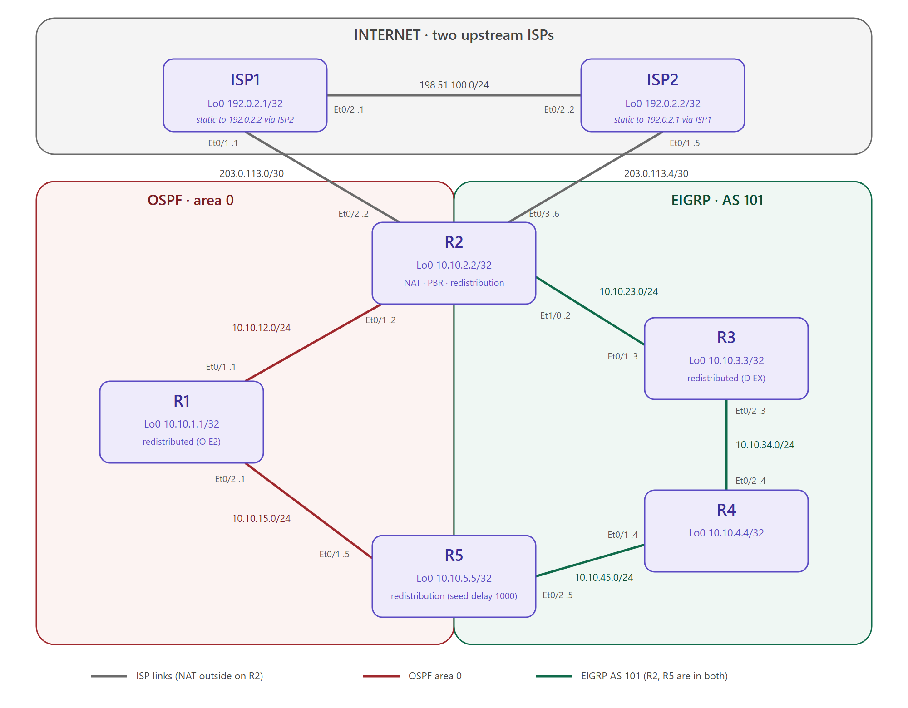
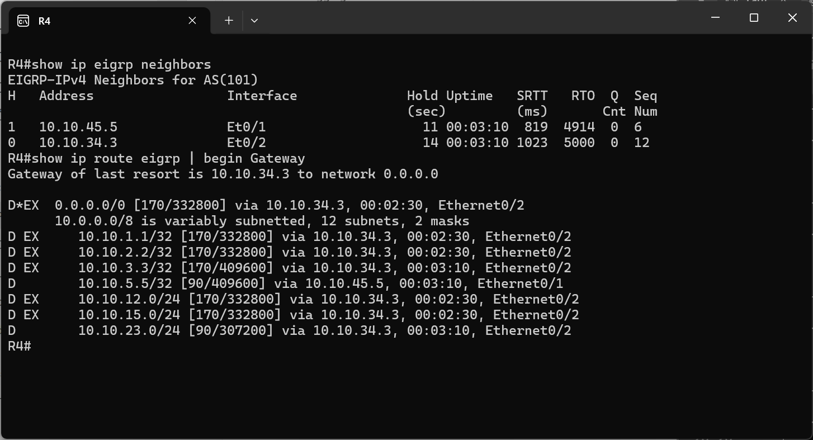
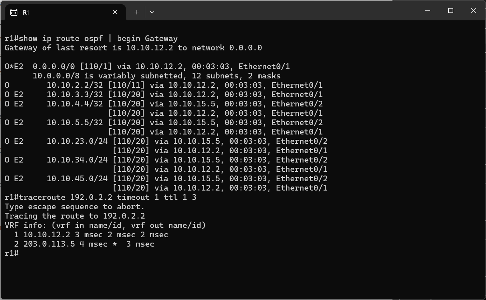
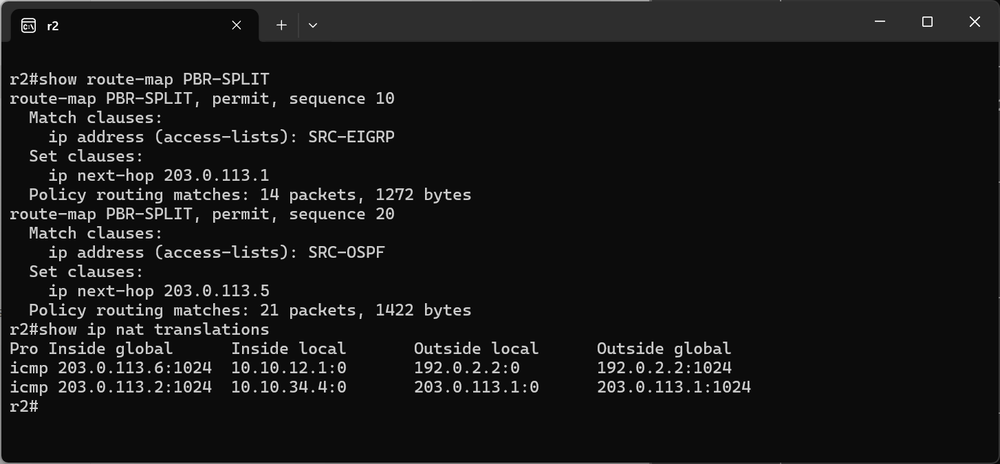
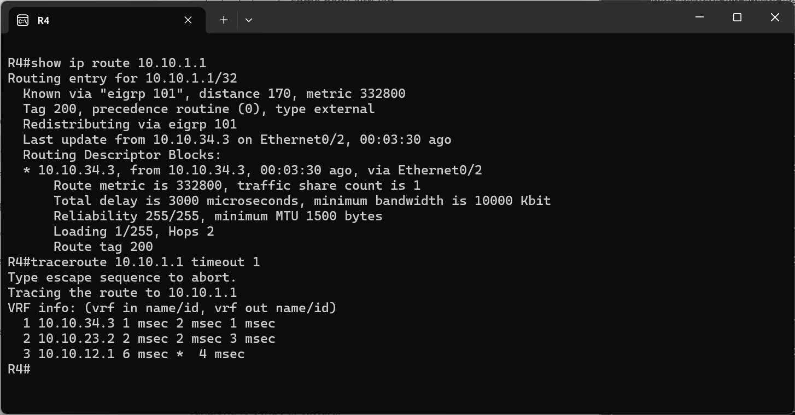
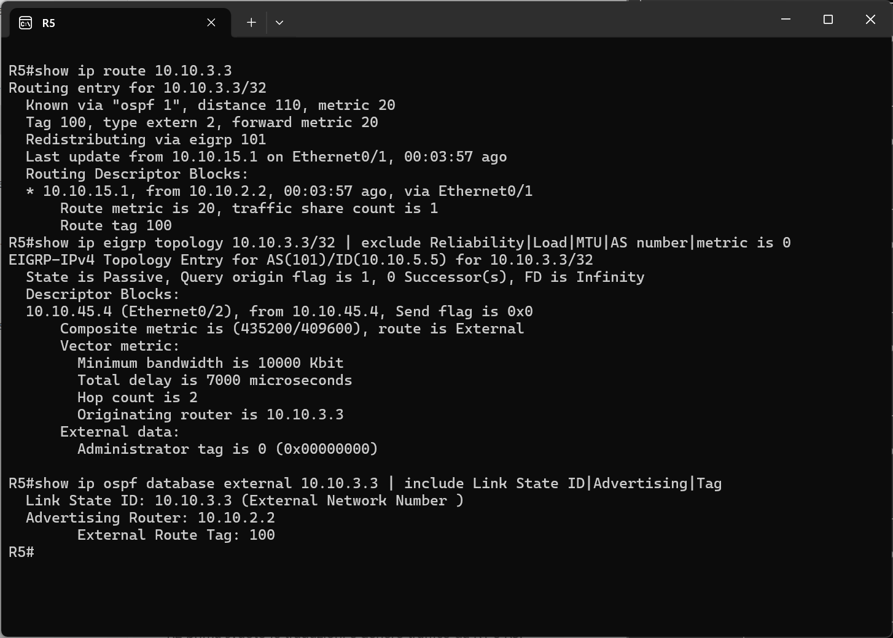

# PBR and Route Redistribution Lab

## Credits

This lab is based on "LAB08 - PBR - route redistribution" from the ENARSI Hands-On v1.0 course material
by [Magnetico Associazione Culturale](https://www.magnetico.cloud/).

## Topology

A [containerlab](https://containerlab.dev/) topology with 7 Cisco IOL routers: five enterprise routers split between an OSPF domain and an EIGRP domain, plus two upstream ISPs. R2 is the only router connected to the Internet, and R2 and R5 are the two points where the routing domains meet. The lab covers two topics: **policy-based routing**, which picks an ISP using something other than the destination address, and **mutual redistribution** between OSPF and EIGRP at two points, with the route-feedback and administrative-distance problems that come with it.



- **OSPF, area 0**: R1, plus R2's Et0/1 and Lo0 and R5's Et0/1. R1's Lo0 isn't in OSPF directly. It is injected with `redistribute connected route-map REDISTRIBUTE-THIS` (match on Loopback0), so it is an external `O E2` route from the start.
- **EIGRP AS 101**: R3, R4, plus R2's Et1/0 and R5's Et0/2 and Lo0. R3's Lo0 is not covered by a `network` statement but injected with `redistribute connected`, so it is an external `D EX` route from the start.
- **R2 and R5** run both protocols and are the redistribution points. R2 is also the Internet edge: two static defaults (ISP1 primary, ISP2 floating with AD 5), NAT overload toward both ISPs and the PBR.
- **ISP1 and ISP2** only know their connected networks plus a static route to each other's Lo0 over 198.51.100.0/24. They have no route to 10.10.0.0/16, and each one knows only its own /30 toward R2.

| Config file | Hostname | Role | Lo0 | Et0/1 | Et0/2 | Et0/3 | Et1/0 | Mgmt IP |
|---|---|---|---|---|---|---|---|---|
| `configs/r1.cfg` | r1 | OSPF | 10.10.1.1/32 (redistributed) | 10.10.12.1/24 (R2) | 10.10.15.1/24 (R5) | | | 172.20.20.10 |
| `configs/r2.cfg` | r2 | Internet edge, ASBR | 10.10.2.2/32 (OSPF) | 10.10.12.2/24 (R1) | 203.0.113.2/30 (ISP1) | 203.0.113.6/30 (ISP2) | 10.10.23.2/24 (R3) | 172.20.20.20 |
| `configs/r3.cfg` | R3 | EIGRP | 10.10.3.3/32 (redistributed) | 10.10.23.3/24 (R2) | 10.10.34.3/24 (R4) | | | 172.20.20.30 |
| `configs/r4.cfg` | R4 | EIGRP | 10.10.4.4/32 | 10.10.45.4/24 (R5) | 10.10.34.4/24 (R3) | | | 172.20.20.40 |
| `configs/r5.cfg` | R5 | ASBR | 10.10.5.5/32 (EIGRP) | 10.10.15.5/24 (R1) | 10.10.45.5/24 (R4) | | | 172.20.20.50 |
| `configs/isp1.cfg` | isp1 | ISP | 192.0.2.1/32 | 203.0.113.1/30 (R2) | 198.51.100.1/24 (ISP2) | | | 172.20.20.60 |
| `configs/isp2.cfg` | isp2 | ISP | 192.0.2.2/32 | 203.0.113.5/30 (R2) | 198.51.100.2/24 (ISP1) | | | 172.20.20.70 |

containerlab's `ethN` maps to IOL's `Ethernet0/N` for N ≤ 3, and `eth4` becomes `Ethernet1/0` (IOL has four ports per slot). That's why R2's link to R3 is Et1/0. `Ethernet0/0` is always the management interface (in the `clab-mgmt` VRF). The first task of the exercise (`configure replace tftp://...`) isn't needed here: containerlab loads the starting configuration as each node's startup config.

### Starting point

`configs/` holds the **final** state with the tasks applied. The initial configs of the exercise are kept in [`magnetico-lab-templates/pbr-route_distribution/configs/`](../magnetico-lab-templates/pbr-route_distribution/configs/). In that state OSPF already works, EIGRP has no adjacencies at all, R2 translates everything with Et0/3's address, and nothing is redistributed between the two protocols.

## Fixing the EIGRP adjacencies

The first real task is troubleshooting: none of the four EIGRP routers had a neighbor. There were four independent faults:

| Router | Fault | Fix |
|---|---|---|
| R2 | `network 10.10.23.1 0.0.0.0` matches R3's side of the link, not R2's address (.2), so EIGRP never starts on Et1/0. `distance eigrp 255 255` would also keep every EIGRP route out of the routing table. | `network 10.10.23.2 0.0.0.0`, `no distance eigrp 255 255` |
| R3 | No `network` statement at all, only `redistribute connected`, so EIGRP runs on no interface. | `network 10.10.23.3 0.0.0.0`, `network 10.10.34.3 0.0.0.0` |
| R4 | Et0/1 (toward R5) has no IP address. | `ip address 10.10.45.4 255.255.255.0` |
| R5 | `network 10.10.45.0 0.0.0.0`: with a 0.0.0.0 wildcard it matches only the exact address 10.10.45.0, not R5's 10.10.45.5. `distance eigrp 255 255` as on R2. | `network 10.10.45.5 0.0.0.0`, `no distance eigrp 255 255` |

AD 255 means "unknown source": a route with that distance is never installed. It doesn't stop the adjacency, so the routes still show up in `show ip eigrp topology` but not in `show ip route`. It matters later too, because redistribution takes its routes from the routing table, not from the topology table: with AD 255 on R2 and R5 there would be nothing to redistribute from EIGRP into OSPF.

R3's `redistribute connected` is left in place. It's what makes R3's Lo0 an external route, and that is the cause of the [AD problem described at the end](#the-ad-problem-with-r3s-loopback-not-fixed).

R4 now has both neighbors, R5 on Et0/1 and R3 on Et0/2. Its routing table already shows the result of the later tasks: the default route and the OSPF prefixes arrive as `D EX` via R3, and R5's Lo0 is an internal `D` route via R5:



## NAT per exit interface

This is not one of the lab tasks, but the PBR can only be verified once it's in place. The initial NAT on R2 has a single rule:

```
ip nat inside source list 1 interface Ethernet0/3 overload
```

The `interface` keyword only chooses **which address** to translate to. It is not a condition on the exit interface. Everything leaving R2 is translated to 203.0.113.6, even traffic sent to ISP1. ISP1 knows only 203.0.113.0/30, so its replies to .6 are lost: a plain `ping 192.0.2.1` from R2 fails with this config.

The fix is one rule per ISP, each selecting the traffic that leaves through that ISP's interface:

```
! R2
route-map NAT-ISP1 permit 10
 match ip address 1
 match interface Ethernet0/2
route-map NAT-ISP2 permit 10
 match ip address 1
 match interface Ethernet0/3
!
ip nat inside source route-map NAT-ISP1 interface Ethernet0/2 overload
ip nat inside source route-map NAT-ISP2 interface Ethernet0/3 overload
```

Two `match` clauses in the same sequence are ANDed: the packet must match ACL 1 (`permit any`) **and** leave through that interface. The two route-maps can't overlap, because a packet leaves through one interface only. Traffic toward ISP1 is translated to 203.0.113.2 and traffic toward ISP2 to 203.0.113.6, so each ISP sees a source address it can route back to.

Removing the old rule requires `clear ip nat translation *` first. As long as a translation built on it exists, IOS refuses the change with `%Dynamic mapping in use, cannot change`.

## Default route into both domains

R1, R3 and R4 had no route to the Internet, so their traffic never reached R2 and the PBR would never see it. R2, the only router with the real default, originates it in both protocols:

```
! R2
router ospf 1
 default-information originate
!
ip prefix-list DEFAULT-ONLY seq 5 permit 0.0.0.0/0
route-map DEFAULT-TO-EIGRP permit 10
 match ip address prefix-list DEFAULT-ONLY
router eigrp 101
 redistribute static metric 10000 100 255 1 1500 route-map DEFAULT-TO-EIGRP
```

OSPF has a dedicated command for the default. Without `always`, R2 advertises it only while it has a default in its own routing table, so it stops attracting traffic if both ISPs are lost. R1 receives it as `O*E2 0.0.0.0/0 [110/1]`: metric 1 is the default for `default-information originate`, while other redistributed routes get 20.

EIGRP has no equivalent command, so the static route is redistributed, with a prefix-list limiting it to 0.0.0.0/0. The prefix-list, not an ACL, is used because the filter selects a **route**, not packets. R4 receives it as `D*EX` with metric 332800 (see the screenshot above). With the default K-values only bandwidth and delay count: 256 × (10⁷/10000 + 100 seed + 100 for R3's interface + 100 for R4's interface) = 256 × 1300.

## Policy-based routing

The PBR is applied as presented in class: the traffic of each routing domain uses a different ISP. Traffic from the EIGRP domain goes out through ISP1, traffic from the OSPF domain through ISP2. The routing table can't do this, because the default route is the same for everyone. The decision depends on **who sends** the packet, and a routing table only looks at the destination. A PBR route-map applied on an interface is checked for every packet that enters it, **before** the routing table.

```
! R2
ip access-list extended SRC-EIGRP
 10 deny ip any 10.10.0.0 0.0.255.255
 20 permit ip 10.10.23.0 0.0.0.255 any
 30 permit ip 10.10.34.0 0.0.0.255 any
 40 permit ip 10.10.45.0 0.0.0.255 any
 50 permit ip host 10.10.3.3 any
 60 permit ip host 10.10.4.4 any
 70 permit ip host 10.10.5.5 any
ip access-list extended SRC-OSPF
 10 deny ip any 10.10.0.0 0.0.255.255
 20 permit ip 10.10.12.0 0.0.0.255 any
 30 permit ip 10.10.15.0 0.0.0.255 any
 40 permit ip host 10.10.1.1 any
!
route-map PBR-SPLIT permit 10
 match ip address SRC-EIGRP
 set ip next-hop 203.0.113.1
route-map PBR-SPLIT permit 20
 match ip address SRC-OSPF
 set ip next-hop 203.0.113.5
!
interface Ethernet0/1
 ip policy route-map PBR-SPLIT
interface Ethernet1/0
 ip policy route-map PBR-SPLIT
```

- **Extended ACLs, not prefix-lists.** PBR evaluates packets, so it needs packet fields (source, destination, protocol, ports). Prefix-lists describe routes (prefix and length) and are the tool for redistribution and routing filters instead.
- **The sources.** When a router originates a packet, its source is the address of the exit interface chosen by its routing table. R3 uses 10.10.23.3 and R4 10.10.34.4. R1 uses 10.10.12.1. R5 uses 10.10.15.5: its default is the OSPF one (AD 110 beats EIGRP's 170), so R5 belongs to the OSPF side for Internet traffic. The loopbacks are listed for traffic sourced from them.
- **The `deny` toward 10.10.0.0/16** is on the **destination**. Without it, traffic from R4 to R1's networks would also enter R2 on Et1/0, match the policy and be sent to ISP1, even though R2 has the destination as a connected or OSPF route. A `deny` in a PBR ACL doesn't drop the packet: it just doesn't match the route-map, and the packet is forwarded by the routing table.
- **Ingress interfaces.** The policy is applied inbound on both inside interfaces. Traffic generated by R2 itself doesn't enter any interface, so it would need `ip local policy route-map` instead.

PBR and NAT work in sequence. The PBR chooses the exit interface, then the per-interface NAT chooses the address. On R1, a traceroute to ISP2's loopback goes through R2 and then directly to 203.0.113.5. The same screenshot shows the OSPF default (`O*E2`, metric 1) and the EIGRP prefixes redistributed into OSPF, all `O E2` with metric 20 and two equal paths, one through each ASBR:



On R2 both sequences of the route-map are matching packets. The NAT table shows the two domains leaving through different ISPs: R1 (10.10.12.1) is translated to 203.0.113.6 (ISP2) and R4 (10.10.34.4) to 203.0.113.2 (ISP1):



The PBR also limits what each domain can reach. R1's traffic always leaves through ISP2, so `ping 203.0.113.1` from R1 fails with `U` (unreachable): ISP2 has no route to ISP1's /30. Pings to each ISP's loopback across the *other* ISP fail as well. The packet gets there over 198.51.100.0/24, but the reply is addressed to R2's /30 on the first ISP, and the second ISP has no route back to it.

> **ACL counters.** With PBR, the ACL hit counters aren't reliable (here they only count the `deny` line). Check the route-map's `Policy routing matches` instead, or `debug ip policy`.

### The exercise's version: destination-based PBR

The exercise text asks for something different: *make ISP2's Loopback0 reachable through ISP1, and vice versa*. The criterion is the destination, not the sender. It is not configured in this lab, but it would look like this:

```
! R2 (not configured)
ip access-list extended DST-ISP2-LO
 permit ip any host 192.0.2.2
ip access-list extended DST-ISP1-LO
 permit ip any host 192.0.2.1
route-map PBR-DST permit 10
 match ip address DST-ISP2-LO
 set ip next-hop 203.0.113.1
route-map PBR-DST permit 20
 match ip address DST-ISP1-LO
 set ip next-hop 203.0.113.5
!
interface Ethernet0/1
 ip policy route-map PBR-DST
interface Ethernet1/0
 ip policy route-map PBR-DST
ip local policy route-map PBR-DST
```

The two versions solve different problems:

- **Destination-based PBR can't split the traffic per domain.** A ping from R1 and a ping from R4 to 192.0.2.2 have the same destination, so a destination-only rule treats them the same. Only the source (or the ingress interface) tells them apart.
- **Destination-only PBR is what static routes already do.** `ip route 192.0.2.2 255.255.255.255 203.0.113.1` and `ip route 192.0.2.1 255.255.255.255 203.0.113.5` would give the same result. PBR is really useful when the decision depends on fields that the routing table never looks at: source, protocol, ports, DSCP, packet length.
- **The replies have the same problem as above.** The ISP that answers is the one that owns the loopback, and it only knows its own /30 toward R2. With the per-interface NAT, each request leaves with the address of the *other* ISP's /30, so neither reply comes back. With the original single rule (always 203.0.113.6), the path to 192.0.2.2 works and the one to 192.0.2.1 doesn't. The PBR itself can still be verified with the first hop of a traceroute and the route-map counters.

## Mutual redistribution between OSPF and EIGRP

The last task asks for mutual redistribution on R2 and R5, with R4 reaching R1's loopback through **R1-R2-R3-R4**, not through the shorter R1-R5-R4. Two redistribution points are what make the task interesting. With a single point, a route can only cross from one domain to the other once. With two, it can leave through one router and come back in through the other (**route feedback**).

```
! R2 and R5
route-map EIGRP-TO-OSPF deny 10
 match tag 200
route-map EIGRP-TO-OSPF permit 20
 set tag 100
!
route-map OSPF-TO-EIGRP deny 10
 match tag 100
route-map OSPF-TO-EIGRP permit 20
 set tag 200
!
router ospf 1
 redistribute eigrp 101 route-map EIGRP-TO-OSPF
!
! R2
router eigrp 101
 redistribute ospf 1 metric 10000 100 255 1 1500 route-map OSPF-TO-EIGRP
! R5
router eigrp 101
 redistribute ospf 1 metric 10000 1000 255 1 1500 route-map OSPF-TO-EIGRP
```

- **Route tags as a mark of origin.** The tag is a 32-bit value the protocols carry without using it. Tag 100 means "born in EIGRP", tag 200 "born in OSPF". The first border router stamps the route when it redistributes it. The other one reads the stamp and refuses to send the route back where it came from. Both routers need both route-maps, because which one stamps and which one reads depends on the route: R2 puts 10.10.1.1 into EIGRP with tag 200 and R5 must block it toward OSPF, while R5 puts 10.10.4.4 into OSPF with tag 100 and R2 must block it toward EIGRP. OSPF can carry a tag only on external LSAs (types 5 and 7), which is fine here, since every redistributed route is external.
- **Seed metric toward EIGRP only.** OSPF gives redistributed routes a usable default (metric 20, type E2), so `redistribute eigrp` needs no metric. EIGRP's default seed metric is infinite, so OSPF routes would never be advertised without `metric`. The exceptions are connected and static routes, and another EIGRP process. All five values (bandwidth, delay, reliability, load, MTU) must be given, but with the default K-values only bandwidth and delay enter the metric. `subnets` is implied on IOS-XE 17 and doesn't appear in the running config.
- **A worse seed metric on R5.** With the same seed on both routers, R4 would pick R5, one hop closer. Delay is the value to tune, because it is additive and its effect is easy to predict. Bandwidth only counts as the path minimum. With delay 1000 on R5, R4 computes 256 × (1000 + 1000 + 100) = **537600** via R5 and 256 × (1000 + 100 + 100 + 100) = **332800** via R3.

On R4, 10.10.1.1 is `D EX` with tag 200 via 10.10.34.3. The reported delay of 3000 µs corresponds to the seed (100) plus two links (in tens of µs). The traceroute follows R3, R2 and R1:



A traceroute alone doesn't prove the task. Before the redistribution, R4 already reached 10.10.1.1 along the same path, through the default route toward R2. The proof is the specific `D EX` route in the routing table. The path through R5 is still there as a backup. `show ip eigrp topology all-links` lists it with 537600/512000. It's not a feasible successor (its reported distance 512000 is higher than the feasible distance 332800), so if the R2–R3 link fails R4 has to query before using it.

R5's OSPF default is redistributed into EIGRP too (tag 200, external protocol OSPF), so R4 also has a backup default through R5 with the same 537600. A `deny` for 0.0.0.0/0 in `OSPF-TO-EIGRP` would keep R2 as the only origin of the default in EIGRP. It's left out here, because the higher seed on R5 already keeps it as a backup only.

## The AD problem with R3's loopback (not fixed)

The redistribution has a side effect that the task doesn't mention, and it is left in place on purpose. R5 reaches R3's loopback through **R1 and R2** (three hops) instead of through R4 (two hops).

1. 10.10.3.3 is an **external** EIGRP route, because R3 injects it with `redistribute connected`. On R2 and R5 it has AD **170**.
2. R2 redistributes it into OSPF (tag 100) and originates a Type-5 LSA.
3. R5 now has two copies: EIGRP via R4 with AD 170, and OSPF via R1 with AD **110**. Between protocols only the administrative distance counts, since their metrics can't be compared, and 110 wins.
4. The OSPF copy goes into R5's routing table. EIGRP still keeps its path in the topology table, but with `0 Successor(s), FD is Infinity`, because the route was not installed.

The administrative distance is not a property of the route. Each router assigns it locally, depending on the protocol it learned the route from. Redistributing a route changes its AD on the routers downstream. That's why the problem only exists in one direction: an EIGRP **external** route (170) loses against its own copy coming back through OSPF (110). An EIGRP internal route (90) wins against it, and an OSPF route (110) always wins against its copy coming back as EIGRP external (170).



Only R5 is affected, and that comes down to timing. Redistribution takes its routes from the routing table. Once R5 has installed the OSPF copy, 10.10.3.3 is no longer an EIGRP route on R5, so R5 doesn't redistribute it and never originates its own LSA. That's why the OSPF database holds a **single** Type-5 LSA for 10.10.3.3, advertised by 10.10.2.2. By comparison, internal EIGRP prefixes such as 10.10.4.4 have two LSAs, one from each ASBR. R2 never receives an OSPF copy from another router: it doesn't use its own LSA as a route, so it keeps the EIGRP path via R3. The outcome depends on which border router redistributes first. After a reload or a flap the roles could swap, with R2 reaching R3 through R1, R5 and R4.

Possible fixes:

- **Make the route internal at the source.** On R3, `network 10.10.3.3 0.0.0.0` instead of relying on `redistribute connected`. As an internal route (AD 90) it always wins against the OSPF copy. It's the cleanest option, but it requires changing the originating router, and it only fixes this one prefix.
- **Raise the AD of the OSPF copy for that prefix** on both border routers:
  ```
  ip access-list standard R3-LO
   permit host 10.10.3.3
  router ospf 1
   distance 171 0.0.0.0 255.255.255.255 R3-LO
  ```
  OSPF routes matching the ACL, from any advertising router, get AD 171 and lose against the EIGRP external route (170). The OSPF copy stays available as a backup. The `distance` command only accepts an ACL, so the selection is per prefix and the ACL has to be maintained by hand.
- **Keep EIGRP-born routes out of the routing table by tag**, on both border routers:
  ```
  route-map OSPF-IN deny 10
   match tag 100
  route-map OSPF-IN permit 20
  router ospf 1
   distribute-list route-map OSPF-IN in
  ```
  An OSPF `distribute-list in` filters what goes into the routing table, not the LSA database: the LSAs are still flooded to R1. This covers every EIGRP-born route automatically, including future ones, but the border routers lose the OSPF copy as a backup for those prefixes. The `permit 20` is required, otherwise the implicit deny would drop every OSPF route.

A global change such as `distance ospf external 171` doesn't work in this topology. Both domains contain external routes (10.10.1.1 is `O E2`, 10.10.3.3 is `D EX`), so a rule per protocol that fixes one breaks the other: R5 would reach R1's loopback, and the default, through EIGRP.

## Running the lab

```bash
# deploy / destroy (from the pbr-route_distribution directory)
clab deploy
clab destroy --cleanup
```

The nodes `r1`–`r5`, `isp1` and `isp2` are reachable via containerlab console/exec or SSH on 172.20.20.10–70 (user `admin`). `scripts/lab_tools.py` can export the running configs back into `configs/` (`export-configs --topo pbr-route-redistribution.clab.yml`) and open an SSH session to every router at once (`open-sessions`).
