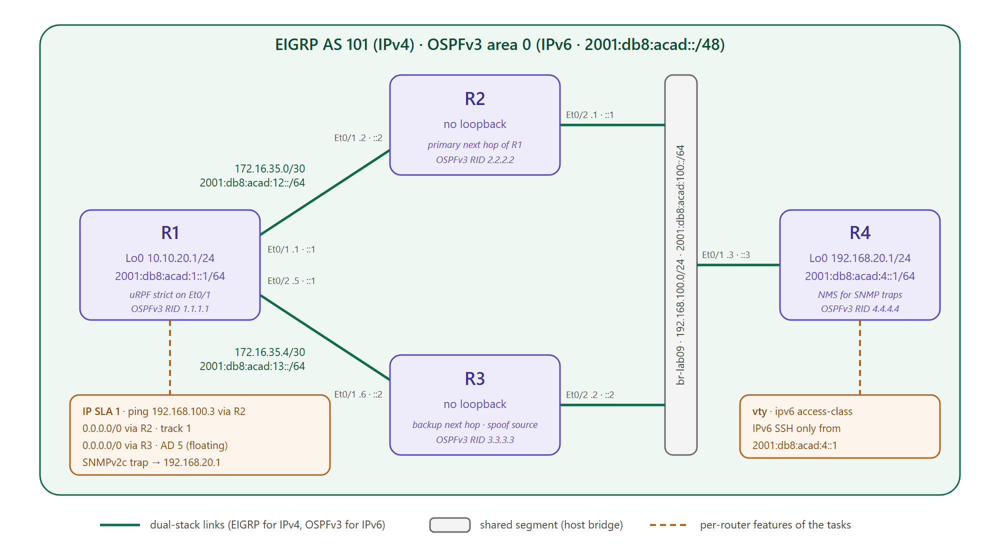
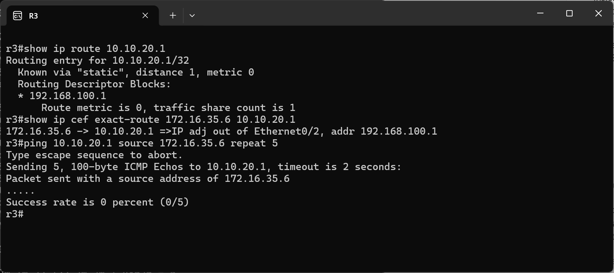
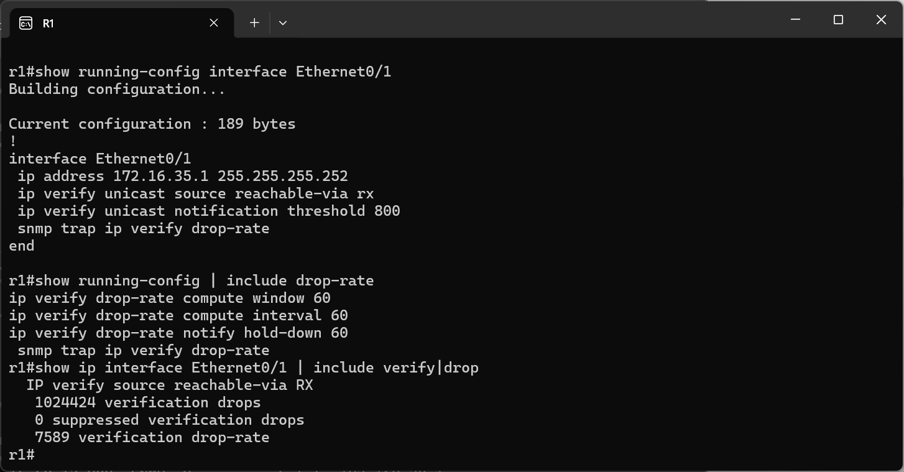
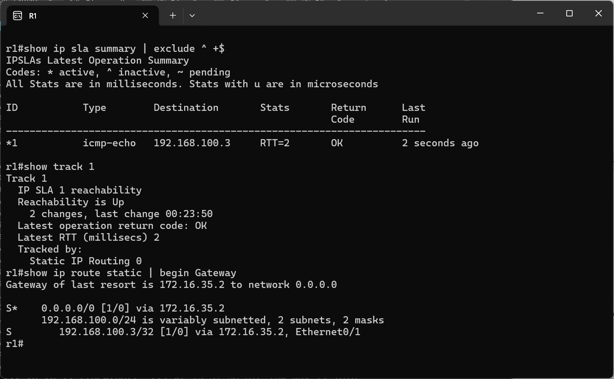
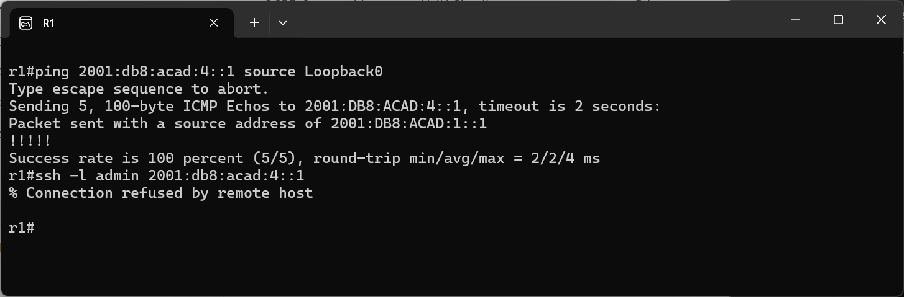
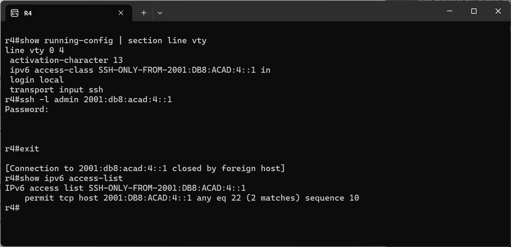

# uRPF, IP SLA, NetFlow, Archive and IPv6 Lab

## Credits

This lab is based on "LAB09 - RPF, IP SLA, Netflow, Archive" from the ENARSI Hands-On v1.0 course material
by [Magnetico Associazione Culturale](https://www.magnetico.cloud/).

## Topology

A [containerlab](https://containerlab.dev/) topology with 4 Cisco IOL routers. R1 is the edge router: it has two uplinks, one to R2 and one to R3, and R2, R3 and R4 share a single Ethernet segment. EIGRP AS 101 already routes all the IPv4 networks in the starting configuration. The lab adds infrastructure services on top: **unicast RPF** against IP spoofing, with **SNMP notifications** when the drop rate is too high, a default route that depends on an **IP SLA** probe, and **IPv6** with OSPFv3 plus a filter on IPv6 SSH access. **NetFlow** and **Archive** are covered in the text only (see [below](#not-configured-archive-and-flexible-netflow)).



- **IPv4**: EIGRP AS 101 with `network 0.0.0.0` on every router. R1 reaches the shared segment 192.168.100.0/24 and R4's loopback through two equal-cost paths, via R2 and via R3. This ECMP matters for the uRPF and the IP SLA tasks.
- **IPv6**: every lab interface is dual stack, with a /64 from 2001:db8:acad::/48 and OSPFv3 area 0.
- **R1** holds most of the tasks: uRPF and SNMP traps on Et0/1, and the IP SLA, the track object and the two default routes.
- **R4** plays the NMS: its Loopback0, 192.168.20.1, is the destination of the SNMP traps. It also has the IPv6 SSH filter.
- **The shared segment** is a containerlab host bridge (`br-lab09`), so it must exist before the deploy.

| Config file | Hostname | Role | Lo0 | Et0/1 | Et0/2 | Mgmt IP |
|---|---|---|---|---|---|---|
| `configs/r1.cfg` | r1 | edge, uRPF, IP SLA | 10.10.20.1/24<br>2001:db8:acad:1::1/64 | 172.16.35.1/30 (R2)<br>2001:db8:acad:12::1/64 | 172.16.35.5/30 (R3)<br>2001:db8:acad:13::1/64 | 172.20.20.10 |
| `configs/r2.cfg` | r2 | primary next hop | | 172.16.35.2/30 (R1)<br>2001:db8:acad:12::2/64 | 192.168.100.1/24 (segment)<br>2001:db8:acad:100::1/64 | 172.20.20.20 |
| `configs/r3.cfg` | r3 | backup next hop, spoof source | | 172.16.35.6/30 (R1)<br>2001:db8:acad:13::2/64 | 192.168.100.2/24 (segment)<br>2001:db8:acad:100::2/64 | 172.20.20.30 |
| `configs/r4.cfg` | r4 | NMS, IPv6 SSH filter | 192.168.20.1/24<br>2001:db8:acad:4::1/64 | 192.168.100.3/24 (segment)<br>2001:db8:acad:100::3/64 | | 172.20.20.40 |

The topology file names the IOL interfaces directly (`Ethernet0/N`). `Ethernet0/0` is always the management interface, in the `clab-mgmt` VRF. The exercise uses subinterfaces on R1: its `eth0/0.12` (toward R2) is **Et0/1** here and `eth0/0.13` (toward R3) is **Et0/2**. The first task of the exercise (`configure replace tftp://...`) isn't needed: containerlab loads the starting configuration as each node's startup config.

### Starting point

`configs/` holds the **final** state with the tasks applied. The initial configs of the exercise are kept in [`magnetico-lab-templates/rpf-ipsla-netflow-archive/configs/`](../magnetico-lab-templates/rpf-ipsla-netflow-archive/configs/): IPv4 addressing and EIGRP only.

## Unicast RPF on R1

### RPF and uRPF

The exercise calls the objective "RPF", but everything in it is **uRPF**: the MIB is the CISCO-IP-**URPF**-MIB and the notification is `cipUrpfIfDropRateNotify`. The two share the same idea, a *reverse path* check: a router looks at a packet's **source** and asks which interface it would use to send traffic **back** to that source. They use it for different reasons.

| | RPF | uRPF |
|---|---|---|
| Traffic | multicast | unicast |
| Purpose | prevent loops and duplicates | drop spoofed source addresses |
| Enabled | automatically with PIM | manually, per interface |
| Typical command | `show ip rpf <source>`, `show ip mroute` | `ip verify unicast source reachable-via ...` |

In multicast, RPF is what keeps the distribution tree loop-free: a router only accepts a multicast packet on the interface toward the source and drops copies that arrive by another way. uRPF applies the same check to unicast traffic, as an anti-spoofing filter.

### Strict or loose

A router normally forwards on the destination only and never checks the source. An attacker can put any source address in a packet: to hide in a DoS, to make the replies of a reflection attack hit a victim, or to pass an ACL as a trusted host. uRPF has two modes:

- **Strict** (`reachable-via rx`): the route back to the source must use **the same interface** the packet arrived on.
- **Loose** (`reachable-via any`): the source only has to be in the routing table, through any interface. It only drops sources the router can't route at all, such as bogons or unannounced private ranges.

The exercise asks to protect Et0/1, and the attack of the next task uses 172.16.35.6 as source. That address is in R1's routing table, connected on Et0/2. Loose mode would let it through, so this is a job for strict mode:

```
! R1
interface Ethernet0/1
 ip verify unicast source reachable-via rx
```

Strict mode requires CEF (`ip cef`, on by default). It fits interfaces where routing is symmetric, like links toward customers or LANs: it's the usual way to apply BCP38 ingress filtering. On multihomed links, where traffic can come back through a different interface, strict mode would drop good traffic, and loose mode is used instead.

ECMP doesn't break it here. R1 reaches 192.168.100.0/24 and 192.168.20.0/24 through both Et0/1 and Et0/2, and strict mode accepts a packet when the ingress interface is **one of** the equal-cost paths. What strict mode drops on Et0/1 is any source that R1 would reach **only** through another interface, and any source it can't reach at all. It doesn't catch every spoofed packet either: a packet arriving from R2 with a fake source in 192.168.100.0/24 passes, because that network is legitimately reachable through Et0/1 too.

### Simulating the attack

The exercise simulates spoofing from R3 with a static route. Without it, R3 reaches 10.10.20.1 over its direct link to R1, the packets enter R1 on Et0/2, and the check passes. The /32 wins over the EIGRP /24 by longest match and sends the same packets through R2, so they enter R1 on Et0/1 with a source that R1 knows only behind Et0/2:

```
! R3
ip route 10.10.20.1 255.255.255.255 192.168.100.1
```

**This route is left in `configs/r3.cfg` on purpose**, so that the uRPF can be tested right after the deploy. Its side effect is that all of R3's traffic to 10.10.20.1 takes the longer path through R2, not only the spoofed one.



The ping from R3 fails because R1 drops every request on Et0/1. On R1, `show ip interface` shows the counters. In this capture, taken after a few floods with `repeat 100000 timeout 0`, 1,024,424 packets have been dropped, and the last computed drop rate is 7589 packets per second:



## SNMP notifications on uRPF drops

The NOC wants a trap on the NMS, 192.168.20.1, when the packets dropped by uRPF on Et0/1 exceed **48000 per minute**. A colleague had already configured this:

```
! R1 (colleague's version)
ip verify drop-rate compute window 60
ip verify drop-rate compute interval 60
ip verify drop-rate notify hold-down 60
interface Ethernet0/1
 ip verify unicast notification threshold 75000
 snmp trap ip verify drop-rate
```

- **`compute window`** is how far back the router looks: the drop rate is the number of drops in the window divided by its length in seconds. Range 30–300 s, default 300.
- **`compute interval`** is how often the calculation runs. Range 30–300 s, default 30. The window must be at least as long as the interval, otherwise drops between two calculations would never be counted. With 60/60, R1 computes once a minute over the minute that just ended.
- **`notify hold-down`** is the minimum time between two notifications, so a long attack doesn't flood the NMS.
- **`notification threshold`** is on the interface. The drop rate goes above it, and the router sends a syslog message, plus an SNMP trap if `snmp trap ip verify drop-rate` is configured.

Two things were wrong.

**The threshold is in packets per second**, whatever the window. A 60-second window makes it look like a per-minute value, but 75000 means 75000 pps, i.e. 4.5 million packets per minute: almost 100 times the requirement. The correct value is 48000 / 60 = **800**. This is also the answer to the exam question the task is based on (the four options are 48000, 800, 80 and 8000). 48000 repeats the requirement without converting it (60 times too high), 8000 means 480000 per minute (10 times too high), and 80 means 4800 per minute (10 times too low, so the trap would fire too early).

**The trap had nowhere to go.** `snmp trap ip verify drop-rate` generates the notification, but without an SNMP destination it's never sent. The exercise asks for SNMPv2c with community `ENARSI`:

```
! R1
interface Ethernet0/1
 ip verify unicast notification threshold 800
!
snmp-server community ENARSI RO
snmp-server host 192.168.20.1 version 2c ENARSI
```

`snmp-server host` sets the receiver, the version and the community. IOS-XE 17.18 prints a security warning for both commands: v1 and v2c send the community in clear text and have no real authentication. SNMPv3 (users, SHA authentication, AES encryption) is the fix outside the lab, but the task asks for v2c.

> **Auto-enabled traps.** When `snmp-server host` is configured and no `snmp-server enable traps` exists yet, IOS enables **every** trap type the image supports, and the running config shows one `snmp-server enable traps ...` line per category (MPLS, GDOI, Frame Relay and many more). They were removed with `no snmp-server enable traps` to keep the config clean. The uRPF trap doesn't depend on them: it has no category under `snmp-server enable traps` and is enabled only by the interface command. It still fired after the removal.

R4 has no NMS software listening on UDP 162, so it receives the traps and discards them. The check is done on the sender, with `debug snmp packets` and `terminal monitor` on R1, during a flood from R3:

```
*Nov 17 23:11:00.182: SNMP: Queuing packet to 192.168.20.1
*Nov 17 23:11:00.182: SNMP: V2 Trap, reqid 1, errstat 0, erridx 0
 snmpTrapOID.0 = cipUrpfIfDropRateNotify
 cipUrpfIfDropRate.2 = 9026
*Nov 17 23:11:00.433: SNMP: Packet sent via UDP to 192.168.20.1
```

`snmpTrapOID.0` identifies the notification type, `cipUrpfIfDropRateNotify` from the CISCO-IP-URPF-MIB. The varbind `cipUrpfIfDropRate.2` carries the computed rate, 9026 pps, for ifIndex 2, which is Et0/1. A ping flood from R3 reaches about 7500–12500 pps in this lab, so the correct threshold of 800 is exceeded without lowering it for the test.

The trap fires when the rate **crosses** the threshold. Since the rate is only recomputed once a minute, the first trap appears up to a minute after the flood starts. In the tests, a flood started while the rate was still above 800 from the previous one produced no new trap: let the rate go back to 0 before testing again. To see the arrival on R4 as well, one option is `debug ip packet` with an ACL matching UDP 162. It shows the packet, not its content.

## Default route with IP SLA and object tracking

R1 must use a default route via R2 only while the R2-R3-R4 segment is reachable, with R3 as the backup gateway. A plain static route via 172.16.35.2 stays in the table as long as Et0/1 is up. If R2 loses the segment, R1 keeps sending traffic to a router that can't deliver it. The condition has to be measured **beyond** R2, which is what IP SLA does:

```
! R1
ip route 192.168.100.3 255.255.255.255 Ethernet0/1 172.16.35.2
!
ip sla 1
 icmp-echo 192.168.100.3 source-interface Ethernet0/1
  frequency 5
ip sla schedule 1 life forever start-time now
!
track 1 ip sla 1 reachability
!
ip route 0.0.0.0 0.0.0.0 172.16.35.2 track 1
ip route 0.0.0.0 0.0.0.0 172.16.35.6 5
```

The three objects form a chain, and each one has a single job:

1. **IP SLA measures.** Every 5 seconds it sends a ping to R4 (192.168.100.3) and records the result: a return code, RTT and statistics. It knows nothing about routes.
2. **The track interprets.** `reachability` turns the last result into Up or Down. The track is a separate object because every client (static routes, HSRP/VRRP, PBR, EEM) understands only tracks. It can also add logic the probe doesn't have: `state` instead of `reachability` would also go Down when the RTT exceeds the probe's threshold, `delay down/up` avoids flapping on a single lost ping, and `track list` combines several objects.
3. **The static route acts.** It's installed only while track 1 is Up. The second default, via R3 with AD 5, is a **floating static**: it stays out of the table while the primary (AD 1) exists and takes over when it disappears.

The /32 is there because of the ECMP. R1 reaches 192.168.100.0/24 through R2 and R3, so without it the probe could leave through R3. It would keep answering when R2 loses the segment, and the track would never go Down. `source-interface Ethernet0/1` doesn't fix that: it only sets the source address, while the exit interface is always chosen by the routing table. The /32 wins over the EIGRP /24 by longest match. It also names the exit interface: with a next hop alone, R1 would resolve 172.16.35.2 recursively through EIGRP if Et0/1 went down.



The probe returns `OK` with an RTT of 2 ms, track 1 is `Up` and lists `Static IP Routing` as its client, and the default in the routing table is the primary via 172.16.35.2. Only one default is installed: the floating one is ready but not active.

The failover can be tested with a `shutdown` of R2's Et0/2: after a failed probe, track 1 should go Down and `show ip route 0.0.0.0` should show 172.16.35.6 with AD 5, then switch back after `no shutdown`. One detail of the defaults as configured: they name only the next hop. If R1's Et0/1 itself went down, the /32 would disappear, the probe would answer through R3 and the track would stay Up. R1 would then resolve 172.16.35.2 recursively through EIGRP, via R3, and keep the primary in the table. Traffic still flows, but through the "primary" route via R3, and the floating static never gets used. Adding the exit interface to both defaults (`Ethernet0/1 172.16.35.2` and `Ethernet0/2 172.16.35.6`) makes the failover clean in this case too.

> **`control disable` on TCP probes.** Some operations (udp-jitter, udp-echo, tcp-connect) are designed to work with an **IP SLA responder**, a Cisco router configured with `ip sla responder`. Before each test, the source sends a control message on UDP 1967 asking the responder to listen on the test port for a moment. That makes it possible to test any port without a real service behind it. `tcp-connect 203.0.113.10 80 control disable` skips that message and attempts a real three-way handshake. It's needed when the target isn't a Cisco responder (a web server, a Linux host, another vendor), because otherwise the control message gets no answer and the operation fails even if the port is open. If the target is a Cisco router and control is disabled, the port has to be opened permanently with `ip sla responder tcp-connect ipaddress <ip> port <port>`. It's not used here: `icmp-echo` has no control phase.

## Not configured: Archive and Flexible NetFlow

Tasks 5 (Archive) and 6 (NetFlow) are not configured in this lab. They are described here with the configuration they would need.

### Archive: logging configuration changes

The task asks R1 to keep a log of configuration changes, hide passwords in it and send it to 192.168.20.1:

```
! R1 (not configured)
archive
 log config
  logging enable
  logging size 200
  hidekeys
  notify syslog contenttype plaintext
!
logging host 192.168.20.1
```

- `logging enable` turns on the change log, which is off by default. `logging size` sets how many entries are kept in memory (1–1000, default 100).
- `hidekeys` replaces passwords and keys (secret, community, key...) with `*****` in the log.
- `notify syslog` turns every logged command into a syslog message, `%PARSER-5-CFGLOG_LOGGEDCMD`. Without it the log stays in memory and never reaches the remote host: it's the link between the two halves of the task.
- `logging host` sends syslog to 192.168.20.1. The messages are severity 5 (notifications), and the default `logging trap` level is 6 (informational), so they pass.

`show archive log config all` lists each command with the user and session. After `username test secret Cisco123` it would show `username test secret *****`.

The same `archive` menu has a second, unrelated function: **configuration versioning**. `path flash:r1-config` with `maximum 10` keeps numbered copies of the whole running config. `write-memory` creates one at every `write memory`, and `time-period <minutes>` creates them periodically. `show archive` lists them, `show archive config differences` compares two of them, and `configure replace flash:r1-config-2` rolls back to one. The difference from `log config`: versioning saves whole configurations for rollback, while `log config` records single commands as an audit trail (who changed what).

### Flexible NetFlow

The task asks R2 to send R4 the NetFlow statistics of the traffic coming from R1. The exercise uses traditional NetFlow (`ip flow ingress` on the interface and `ip flow-export destination` globally, with a fixed record). Flexible NetFlow, the current form, builds the same thing from three objects:

```
! R2 (not configured)
flow record FR-FROM-R1
 match ipv4 source address
 match ipv4 destination address
 match ipv4 protocol
 match transport source-port
 match transport destination-port
 match interface input
 collect counter bytes
 collect counter packets
 collect timestamp sys-uptime first
 collect timestamp sys-uptime last
!
flow exporter FE-TO-R4
 destination 192.168.20.1
 source Ethernet0/2
 transport udp 2055
 export-protocol netflow-v9
!
flow monitor FM-FROM-R1
 record FR-FROM-R1
 exporter FE-TO-R4
 cache timeout active 60
!
interface Ethernet0/1
 ip flow monitor FM-FROM-R1 input
```

- **The flow record defines what a flow is.** The `match` fields are the **key**: two packets belong to the same flow only if all of them are equal. Here that's the classic 5-tuple plus the ingress interface. The `collect` fields are **measured** for each flow without being part of the key: bytes, packets, first and last packet timestamps. Changing a `match` changes how traffic is grouped. Adding a `collect` only adds information.
- **The flow exporter sets where the data goes**: collector address, source interface, transport (UDP 2055 is the usual collector port) and export format.
- **The flow monitor joins them**: it holds the cache where flows are built, applies the record and hands expired flows to the exporter. `cache timeout active 60` exports long-lived flows every minute instead of after the default 30 minutes. The inactive timeout (15 s by default) handles flows that have stopped.
- **The interface binding sets direction.** "Traffic coming from R1" is traffic that **enters** R2 on Et0/1, so the monitor is applied `input` there.

**Export versions.** NetFlow v5 has a fixed format with IPv4 only and no user-defined fields. v9, the Flexible NetFlow default, is template-based: the exporter first sends a template that describes the fields, then the records. That's what allows custom records and IPv6. IPFIX (`export-protocol ipfix`) is the IETF standard derived from v9. A predefined record, `record netflow ipv4 original-input`, gives roughly the classic v5 content without writing a record by hand.

**Verification** on R2: `show flow monitor FM-FROM-R1 cache` lists the flows with their counters (for example the IP SLA probes from 172.16.35.1 every 5 seconds), `show flow exporter FE-TO-R4 statistics` shows the export packets sent, and `show flow interface Ethernet0/1` confirms the binding.

## IPv6 with OSPFv3

### Addressing

All IPv6 networks come from **2001:db8:acad::/48**. 2001:db8::/32 is the prefix reserved for documentation by RFC 3849, so it is never routed on the Internet. It's the IPv6 counterpart of 192.0.2.0/24 and similar IPv4 ranges, and that's why examples and labs use it.

A /48 leaves 16 bits of subnet ID, which is 65,536 /64 networks. Every network here is a /64, the standard size for an IPv6 link. The subnet ID (the fourth group) encodes what the network is:

| Network | Prefix | Hosts |
|---|---|---|
| R1 Loopback0 | 2001:db8:acad:1::/64 | R1 `::1` |
| R1–R2 | 2001:db8:acad:12::/64 | R1 `::1`, R2 `::2` |
| R1–R3 | 2001:db8:acad:13::/64 | R1 `::1`, R3 `::2` |
| Shared segment | 2001:db8:acad:100::/64 | R2 `::1`, R3 `::2`, R4 `::3` |
| R4 Loopback0 | 2001:db8:acad:4::/64 | R4 `::1` |

Point-to-point links use the numbers of their two routers, loopbacks the number of the router, and the shared segment reuses the third octet of 192.168.100.0/24. Host parts follow the IPv4 addressing: on the R1–R3 link R3 is the second host (`::2`), like .6 is the second host of 172.16.35.4/30, and on the segment R2, R3 and R4 keep .1, .2 and .3. R1's loopback isn't `:20::`, after 10.10.20.0/24, because R4's 192.168.20.0/24 would map to the same subnet ID.

The configuration is dual stack: every lab interface keeps its IPv4 address and gets an IPv6 one with `ipv6 address 2001:db8:acad:<subnet>::<host>/64`. `ipv6 unicast-routing` is already in the starting config. Without it the router would behave as an IPv6 host and forward nothing.

Each IPv6 interface also generates a **link-local** address (FE80::/10) by itself. In IOL it's built with EUI-64 from the MAC: Et0/1 of R1, MAC `aabb.cc00.0210`, gets `FE80::A8BB:CCFF:FE00:210` (`FFFE` inserted in the middle, and `aa` becomes `a8` because the seventh bit is flipped). A loopback has no MAC, so it borrows the one of the first physical interface: R1's Loopback0 and Et0/0 share `FE80::A8BB:CCFF:FE00:200`, which is harmless because a link-local address only matters on its own link. `ipv6 enable` alone would give an interface only the link-local address.

### OSPFv3

```
! R1 (R2, R3 and R4 the same, with their own router-id and interfaces)
router ospfv3 1
 router-id 1.1.1.1
!
interface Loopback0
 ospfv3 network point-to-point
 ospfv3 1 ipv6 area 0
interface Ethernet0/1
 ospfv3 1 ipv6 area 0
interface Ethernet0/2
 ospfv3 1 ipv6 area 0
```

- **No `network` statements.** OSPFv3 is enabled per interface, with the process, the address family and the area. The older syntax, `ipv6 router ospf 1` and `ipv6 ospf 1 area 0` on the interface, still works. The `show ipv6 ospf ...` and `show ospfv3 ...` commands show the same data.
- **The router-id is still a 32-bit dotted value.** Without one, IOS takes it from the IPv4 addresses, which works on a dual-stack router. On an IPv6-only router OSPFv3 doesn't start without an explicit `router-id`. It's set explicitly here, as R2 and R3 have no loopback to take it from.
- **Loopbacks are advertised as /128 by default**, whatever their prefix length. `ospfv3 network point-to-point` makes OSPFv3 advertise the configured /64. Both commands are needed on the loopback: the area command enables OSPFv3 there, and the network type only changes how the prefix is advertised.

![R1: OSPFv3 neighbors 3.3.3.3 on Et0/2 and 2.2.2.2 on Et0/1, both FULL/DR; 2001:DB8:ACAD:4::/64 [110/21] and 2001:DB8:ACAD:100::/64 [110/20], each with two link-local next hops](images/r1_ospfv3_neighbors_ipv6_routes.png)

- **Neighbors.** R1 is FULL with R2 and R3. Adjacencies and next hops use **link-local** addresses: the two next hops `FE80::A8BB:CCFF:FE00:310` and `...:410` are Et0/1 of R2 and R3. OSPFv3 identifies a neighbor's interface by an **Interface ID** (the column in the output), not by an address, because the protocol itself is independent of the IPv6 addresses.
- **DR/BDR elections everywhere.** Ethernet is a broadcast network type for OSPF, so even the two-router links elect a DR. R2 and R3 win against R1 on router-id. On the shared segment R4 (4.4.4.4) is DR, R3 BDR and R2 DROTHER. R2 and R3 are still FULL with each other, because a DROTHER forms full adjacencies with the DR and the BDR. On the point-to-point links `ospfv3 network point-to-point` would skip the election and converge faster.
- **Routes.** R4's loopback arrives as a /64 thanks to the network type. Both prefixes have two equal-cost next hops, like in IPv4 with EIGRP. In IOL every Ethernet link costs 10 (reference bandwidth 100 Mbps over 10 Mbps), so the segment costs 10 + 10 = 20, and R4's loopback 10 + 10 + 1 = 21, where 1 is the cost of the loopback.

OSPFv3 doesn't advertise link-local addresses, so a network with only link-local addresses would form adjacencies but have nothing to route. A real design option is to keep transit links **link-local only** and give global addresses only to loopbacks and LANs. There are fewer addresses to manage and the links are not reachable from outside, at the cost of not being able to ping or traceroute them. Here every interface has a global address, as the task asks.

## IPv6 SSH to R4 only from its loopback

The task allows SSH to R4 over IPv6 "only from R4's loopback". It's applied literally, as a filter on the **source**: only connections sourced from 2001:db8:acad:4::1 are accepted. The only device with that address is R4 itself, so in practice no other router can open an IPv6 SSH session to R4. The other way to read the task, a filter on the **destination** (anyone may connect, but only to the loopback address), is also a common practice: a router is managed through its loopback because the loopback stays reachable as long as any path exists.

```
! R4
ipv6 access-list SSH-ONLY-FROM-2001:DB8:ACAD:4::1
 permit tcp host 2001:DB8:ACAD:4::1 any eq 22
!
line vty 0 4
 ipv6 access-class SSH-ONLY-FROM-2001:DB8:ACAD:4::1 in
```

- **IPv6 ACLs are always named**, and they end with an implicit deny like IPv4 ones.
- **`host`** matches the single loopback address (/128). The /64 would work the same here, since nothing else lives on a loopback, but `host` permits exactly what is needed.
- **`ipv6 access-class`** applies to the vty lines, so it filters who can open a session **on** the router. `ipv6 traffic-filter` is the interface command that filters traffic going **through** it. The access-class is checked when a session opens, and only for IPv6: SSH over IPv4, including the management address 172.20.20.40 used by containerlab and `lab_tools.py`, is not affected.

From R1, R4's loopback answers pings, so routing works, but SSH is refused. R1's source is the address of its exit interface, which is not R4's loopback:



From R4 to its own loopback, the source is the loopback itself, so the session opens, and the ACL's permit line counts its matches:



## Running the lab

```bash
# create the shared-segment bridge if missing (it's a host bridge, so it must exist before deploy)
./scripts/create_bridge.sh br-lab09

# deploy / destroy (from the rpf-ipsla-netflow-archive directory)
clab deploy
clab destroy --cleanup
```

Nodes `r1`–`r4` are reachable via containerlab console/exec or SSH on 172.20.20.10–40 (user `admin`). `scripts/lab_tools.py` can export the running configs back into `configs/` (`export-configs --topo rpf-ipsla-netflow-archive.clab.yml`) and open an SSH session to every router at once (`open-sessions`).

To try the uRPF right away, start a flood from R3 (`ping 10.10.20.1 source 172.16.35.6 repeat 100000 timeout 0`) and watch `show ip interface Ethernet0/1 | include verify|drop` on R1, with `debug snmp packets` and `terminal monitor` to see the trap.
