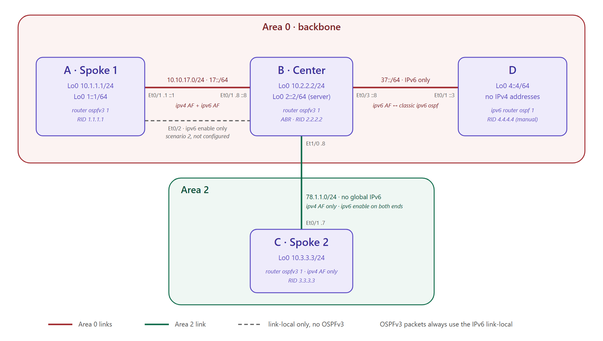
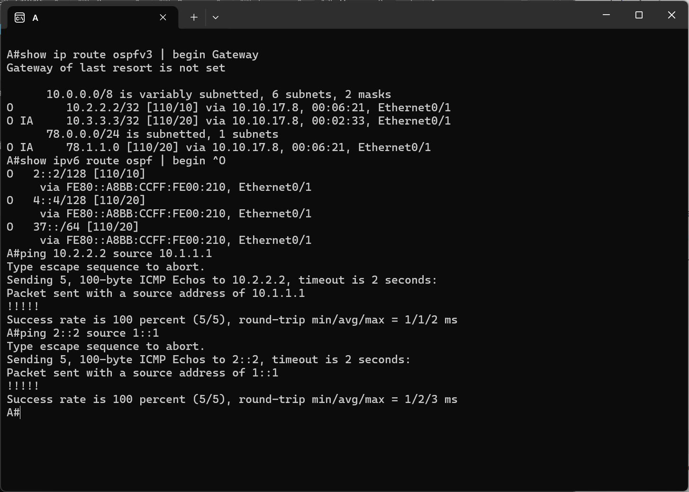
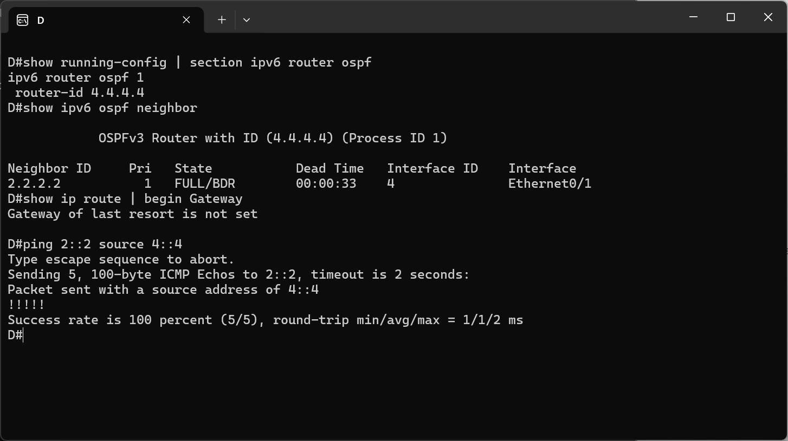
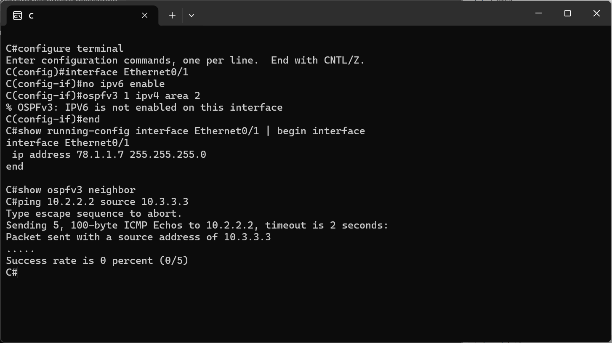
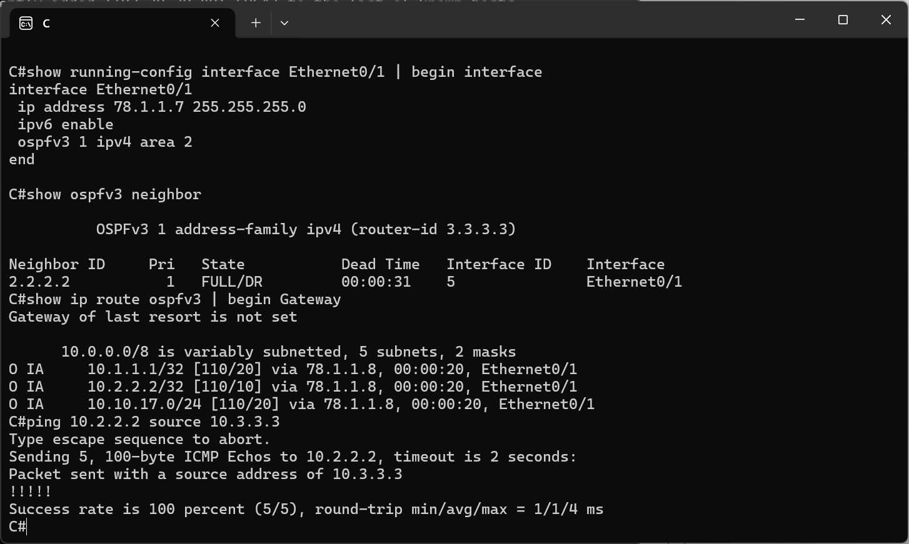
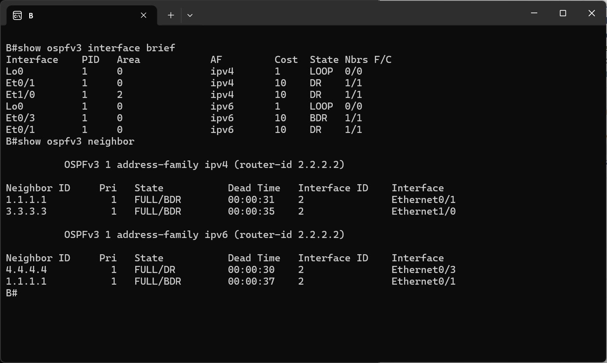

# OSPFv3 Address Families Lab

## Credits

This lab is based on "LAB10 - OSPFv3 address family" from the ENARSI Hands-On v1.0 course material
by [Magnetico Associazione Culturale](https://www.magnetico.cloud/).

## Topology

A [containerlab](https://containerlab.dev/) topology with 4 Cisco IOL routers running OSPFv3. One `router ospfv3 1` process carries both IPv4 and IPv6, each in its own **address family** (AF). The lab compares this style with the classic IPv6-only `ipv6 router ospf`, and shows the role of the IPv6 link-local address: every OSPFv3 packet is sent from it, even when the process only carries IPv4 prefixes. The central part of the lab reproduces an ENARSI exam question in which a spoke can't reach the hub for exactly this reason.



- **Area 0**: A (Spoke 1), B (Center) and D. A and B run both address families with `router ospfv3`. D has no IPv4 address at all and runs the classic `ipv6 router ospf`.
- **Area 2**: C (Spoke 2), connected to B with an IPv4-only link and running only the IPv4 address family.
- **B is the ABR** between area 0 and area 2. Its Loopback0 (`10.2.2.2`, `2::2`) plays the "server at the Center site" of the exam question.
- **The A–B `Et0/2` link** only has `ipv6 enable` and isn't part of OSPF. It belongs to the second scenario of the exercise (an adjacency on a /30), which isn't configured here (see [below](#exam-questions)).

| Config file | Hostname | Role | Loopback0 | Process | Router ID | Mgmt IP |
|---|---|---|---|---|---|---|
| `configs/a.cfg` | A | Spoke 1, area 0 | 10.1.1.1/24, 1::1/64 | `router ospfv3 1` (ipv4 + ipv6 AF) | 1.1.1.1 | 172.20.20.10 |
| `configs/b.cfg` | B | Center, ABR | 10.2.2.2/24, 2::2/64 | `router ospfv3 1` (ipv4 + ipv6 AF) | 2.2.2.2 | 172.20.20.20 |
| `configs/c.cfg` | C | Spoke 2, area 2 | 10.3.3.3/24 | `router ospfv3 1` (ipv4 AF) | 3.3.3.3 | 172.20.20.30 |
| `configs/d.cfg` | D | area 0, IPv6 only | 4::4/64 | `ipv6 router ospf 1` | 4.4.4.4 | 172.20.20.40 |

| Link | IPv4 | IPv6 | Area / AF |
|---|---|---|---|
| A Et0/1 ↔ B Et0/1 | 10.10.17.0/24 (.1, .8) | 17::/64 (::1, ::8) | area 0, ipv4 + ipv6 |
| B Et0/3 ↔ D Et0/1 | — | 37::/64 (::8, ::3) | area 0, ipv6 |
| B Et1/0 ↔ C Et0/1 | 78.1.1.0/24 (.8, .7) | link-local only | area 2, ipv4 |
| A Et0/2 ↔ B Et0/2 | — | link-local only | not in OSPF |

In the course PDF every link is an 802.1Q subinterface of `Ethernet0/0` (for example `Ethernet0/0.78` is VLAN 78 between B and C). Here each link is a separate physical interface: VLAN 17 is `Et0/1`, VLAN 10 is `Et0/2`, VLAN 37 is B `Et0/3` ↔ D `Et0/1`, and VLAN 78 is B `Et1/0` ↔ C `Et0/1`. containerlab's `ethN` maps to IOL's `Ethernet0/N` (`eth4` is `Ethernet1/0`). `Ethernet0/0` is always the management interface, in the `clab-mgmt` VRF.

### Starting point

`configs/` holds the **final** state of the lab. The initial configs of the exercise are kept in [`magnetico-lab-templates/rs-lab10-ospfv3-af/configs/`](../magnetico-lab-templates/rs-lab10-ospfv3-af/configs/). They have the addressing and `ipv6 unicast-routing`, but no OSPF at all and no IPv6 on the B–C link.

## One process, two address families

Between A and B, OSPFv3 carries both IPv4 and IPv6 with the address-family style. The process only declares which families it handles. The address families themselves need no options in this lab:

```
! A (B is the same with router-id 2.2.2.2)
router ospfv3 1
 router-id 1.1.1.1
 !
 address-family ipv4 unicast
 exit-address-family
 !
 address-family ipv6 unicast
 exit-address-family
!
interface Loopback0
 ospfv3 1 ipv4 area 0
 ospfv3 1 ipv6 area 0
!
interface Ethernet0/1
 ospfv3 1 ipv4 area 0
 ospfv3 1 ipv6 area 0
```

OSPFv3 has no `network` command: an interface joins the process, an address family and an area only with the interface command `ospfv3 <process> <ipv4|ipv6> area <area>`. The router ID is set under `router ospfv3`, outside the address families, so it applies to both. Also note that on this IOS release `show running-config | section ospf` lists the interface `ospfv3` lines without their `interface` header. `show ospfv3 interface brief` is a clearer way to check which interfaces are in the process.

Each address family is a separate OSPFv3 instance, with its own hellos, adjacencies, LSDB and SPF. They're told apart by the **instance ID** in the OSPFv3 header: `show ospfv3 interface Ethernet0/1` on B reports `Instance ID 64` for the IPv4 AF and `Instance ID 0` for the IPv6 AF (RFC 5838 reserves 0–31 for IPv6 unicast and 64–95 for IPv4 unicast). Both instances still send their packets from the same IPv6 link-local address, `FE80::A8BB:CCFF:FE00:210` on B's Et0/1.

The routing tables on A show what each family carries. In `show ip route ospfv3` the IPv4 routes use B's IPv4 address `10.10.17.8` as next hop, because forwarding an IPv4 packet needs an IPv4 next hop that ARP can resolve. The IPv4 AF learns it from B's Link LSA (type 8). The IPv6 routes instead point to B's **link-local** address, which is how OSPFv3 always installs IPv6 next hops. Both pings from A's Loopback0 to B's Loopback0 succeed:



A few more details from the same output:

- `show ip route ospf` would show nothing here: it only lists OSPFv2 routes. The IPv4 routes learned through OSPFv3 are filtered with `show ip route ospfv3`, even though they use the same `O` and `O IA` codes.
- The loopbacks are advertised as host routes (`10.2.2.2/32`, `2::2/128`) even though they're configured as /24 and /64, because the OSPF `LOOPBACK` network type only advertises the address itself.
- `10.3.3.3/32`, `78.1.1.0` (C's area 2) and `4::4/128` (D) also show up once the rest of the lab is configured.

## D: the classic style, IPv6 only

D joins area 0 with the classic configuration, which only handles IPv6. B doesn't change style: its Et0/3 is simply added to the IPv6 address family.

```
! D
ipv6 router ospf 1
 router-id 4.4.4.4
!
interface Loopback0
 ipv6 ospf 1 area 0
!
interface Ethernet0/1
 ipv6 ospf 1 area 0

! B
interface Ethernet0/3
 ospfv3 1 ipv6 area 0
```

**The router ID must be set by hand on D.** Even in an IPv6-only process the OSPFv3 router ID is a 32-bit number written as an IPv4 address. Without `router-id`, IOS picks it from the IPv4 addresses of the interfaces in the process's routing table, and D has none. D's `Ethernet0/0` has `172.20.20.40`, but it's in the `clab-mgmt` VRF, so it isn't a candidate for a process running in the global table. Without a configured router ID the process can't start.

**The two styles form an adjacency.** `ipv6 router ospf` and `router ospfv3` are two local syntaxes for the same protocol. On the wire, D's classic process uses instance ID 0, the same as B's IPv6 address family, so the hellos match. `show ipv6 ospf neighbor` on D shows B (`2.2.2.2`) in `FULL` state, and the ping from D's Loopback0 to `2::2` succeeds. D receives no IPv4 routes at all: the classic style has no IPv4 option, and B's Et0/3 is only in the IPv6 AF, so the IPv4 instance never even sends hellos on that link. `show ip route` on D is empty:



## The exam scenario: IPv4 over OSPFv3 without IPv6

The first exam question describes C connected to B in area 2 with only IPv4 on the link. Spoke 1 users (A) can reach the server at the Center site (B), Spoke 2 users (C) can't. The exercise reproduces it by configuring only the IPv4 address family on the B–C link and nothing else.

On C the problem shows up while configuring: without IPv6 on `Ethernet0/1`, IOS answers `% OSPFv3: IPV6 is not enabled on this interface` and **rejects** the command, which doesn't appear in the running config. The screenshot reproduces this state on the final config by removing `ipv6 enable` first. Removing it also removes the `ospfv3 1 ipv4 area 2` line already on the interface, so the command has to be entered again. C has no neighbor, and the ping from its LAN to the server fails:



The link itself is fine: a ping from C to `78.1.1.8` works, so the cabling (VLAN 78 in the original exercise) and the IPv4 addressing are correct. The missing piece is IPv6. OSPFv3 is an IPv6 protocol: its packets are always sent from the interface's **link-local address** to `FF02::5` / `FF02::6`, whatever address family they carry. An interface without IPv6 has no link-local address and can't send or receive OSPFv3 packets.

The minimal fix doesn't need a global IPv6 address: `ipv6 enable` creates the link-local address, and that's all OSPFv3 needs.

```
! B
interface Ethernet1/0
 ip address 78.1.1.8 255.255.255.0
 ipv6 enable
 ospfv3 1 ipv4 area 2

! C
router ospfv3 1
 router-id 3.3.3.3
 !
 address-family ipv4 unicast
 exit-address-family
!
interface Loopback0
 ospfv3 1 ipv4 area 2
!
interface Ethernet0/1
 ip address 78.1.1.7 255.255.255.0
 ipv6 enable
 ospfv3 1 ipv4 area 2
```

With `ipv6 enable` on both ends, C has a `FULL` adjacency with B in the IPv4 address family. The area 0 networks show up on C as `O IA` routes: C is in area 2, and B, as ABR, advertises the area 0 prefixes into area 2 as Inter-Area-Prefix LSAs (the OSPFv3 equivalent of the OSPFv2 type 3 summary LSAs). The next hop is again an IPv4 address, `78.1.1.8`. Spoke 2's LAN now reaches the server:



IPv6 is needed on **both** ends. Removing `ipv6 enable` from B's `Ethernet1/0` brings the adjacency down too. The router where IPv6 is removed drops the neighbor at once, with `Neighbor Down: Interface down or detached` in the log (that's what C logged when the screenshot above was taken). The other side only notices when its dead timer (40 seconds by default on Ethernet) expires, since it simply stops receiving hellos. `ipv6 unicast-routing` is required globally as well, and it's already in place on every router.

## One adjacency per address family

`show ospfv3 neighbor` on B sums up the lab. Neighbors are grouped by address family, and each AF has its own adjacencies:

- **A (`1.1.1.1`)** appears twice, once per AF, because Et0/1 is in both.
- **C (`3.3.3.3`)** appears only in the IPv4 AF, on `Ethernet1/0`.
- **D (`4.4.4.4`)** appears only in the IPv6 AF, on `Ethernet0/3`, even though it runs the classic style.

`show ospfv3 interface brief` gives the same picture per interface. `Et1/0` is in area 2, which makes B the ABR. The loopbacks are in state `LOOP`, and every Ethernet interface has a DR/BDR election, since `BROADCAST` is the default OSPFv3 network type on Ethernet:



## Exam questions

**Question 1**: Spoke 1 users can reach the server at the Center site, Spoke 2 users can't. The answer is **"Configure IPv6 on the routers B and C interfaces"**, as shown above.

- "Configure OSPFv2 on the routers B and C interfaces" would mean running a second routing protocol instead of fixing the one already configured.
- "Configure encapsulation dot1q 78 on the router C interface" is ruled out by the working ping to `78.1.1.8`: the VLAN is already correct.
- "Configure the Spoke 2 users IP on the router B OSPF domain" doesn't address the problem, which is the missing adjacency, not a missing prefix.

**Question 2** (second scenario, the /30 between R1 and R2) isn't configured in this lab, together with the tasks on process numbers and area/VLAN mismatches. The answer is **`R2: ip address 10.10.10.9 255.255.255.252`**. In `10.10.10.8/30`, `10.10.10.11` is the broadcast address, so IOS rejects it and R2's interface is left without an IPv4 address. The other options are distractors:

- The OSPFv3 process number is only locally significant: it isn't carried in the hellos and doesn't have to match between neighbors.
- `ospfv3 network broadcast` changes nothing on Ethernet, where `BROADCAST` is already the default.

## Running the lab

```bash
# deploy / destroy (from the rs-lab10-ospfv3-af directory)
clab deploy
clab destroy --cleanup
```

The nodes `a`, `b`, `c` and `d` are reachable via containerlab console/exec or SSH on 172.20.20.10–40 (user `admin`). `scripts/lab_tools.py` can export the running configs back into `configs/` (`export-configs`) and open an SSH session to every router at once (`open-sessions`).
