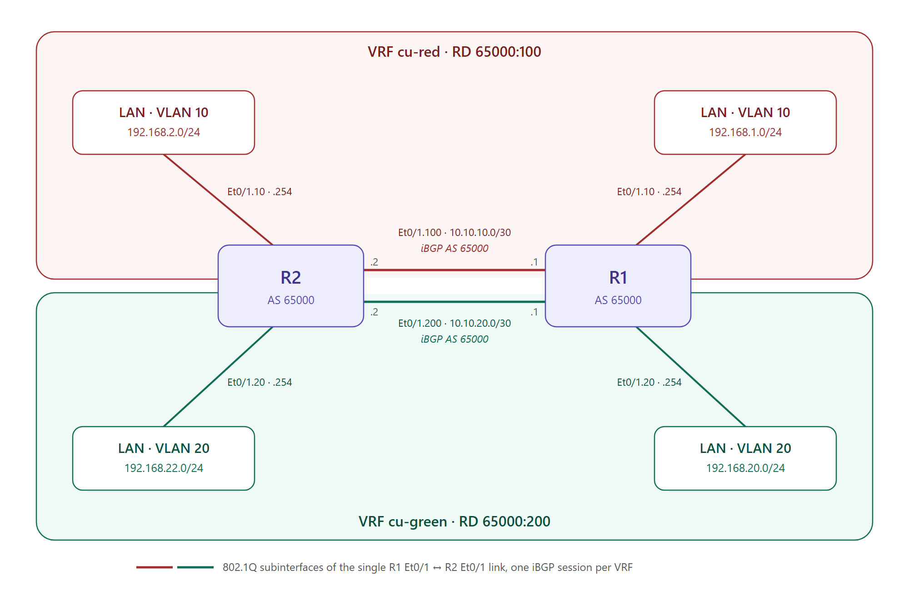
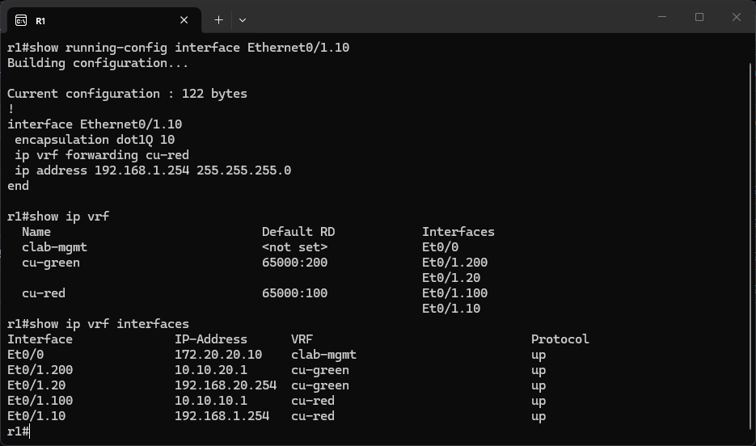
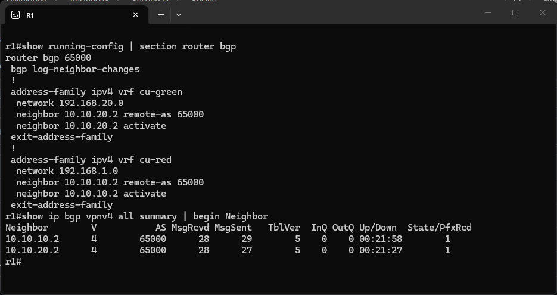
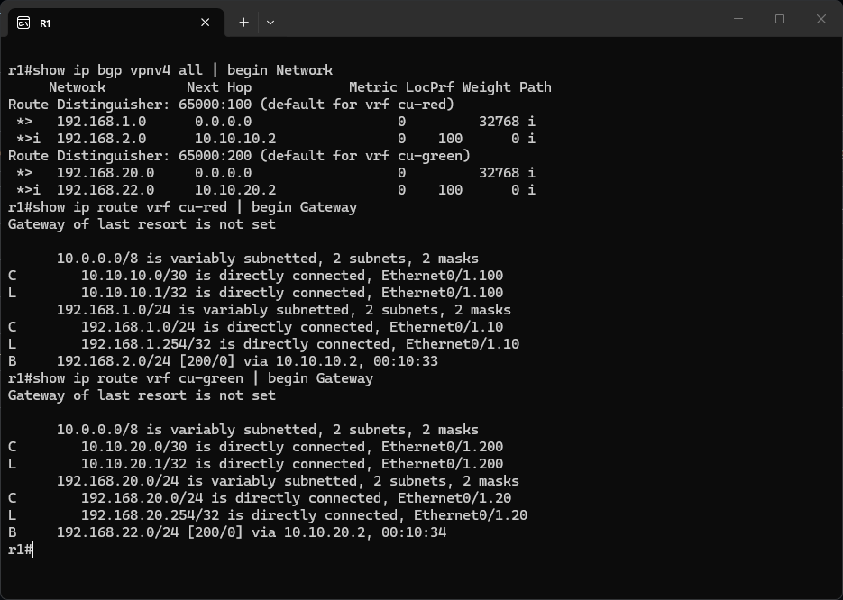
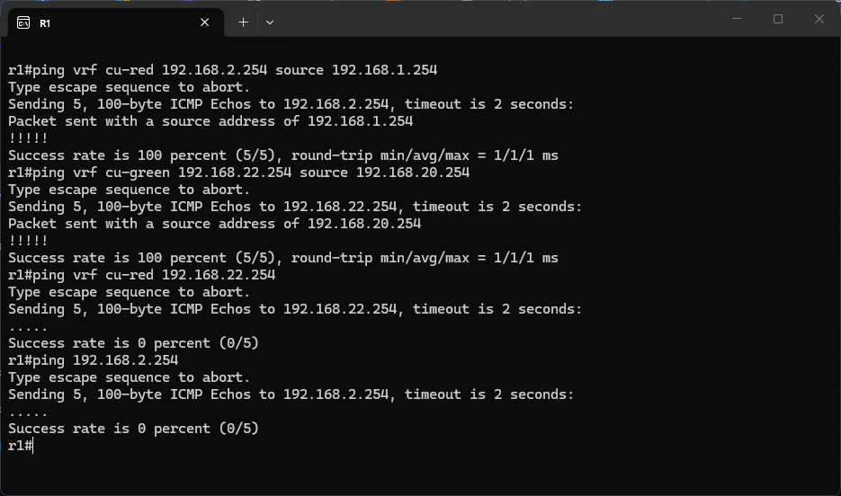

# VRF-Lite Lab

## Credits

This lab is based on "LAB04 - VRF-Lite" from the ENARSI Hands-On v1.0 course material
by [Magnetico Associazione Culturale](https://www.magnetico.cloud/).

## Topology

A [containerlab](https://containerlab.dev/) topology with 2 Cisco IOL routers shared by two customers, `cu-red` and `cu-green`. Each customer has a LAN behind R1 and one behind R2, and the two customers must never see each other's routes. The lab separates them with **VRF-Lite**: one routing table per customer on each router, a dedicated transit subinterface per VRF between R1 and R2, and one iBGP session (AS 65000) per VRF to exchange the LAN prefixes. There's no MPLS and no VPNv4 signalling between the routers: isolation comes only from the separate routing tables and separate links.



- **Physical link**: a single link between R1 `Ethernet0/1` and R2 `Ethernet0/1`, carved into 802.1Q subinterfaces.
- **Transit per VRF**: VLAN 100 (10.10.10.0/30) belongs to `cu-red`, VLAN 200 (10.10.20.0/30) to `cu-green`. The iBGP sessions run here.
- **Customer LANs**: VLAN 10 is the `cu-red` LAN and VLAN 20 the `cu-green` LAN on each router. In the original exercise they're switches (SW1–SW4) behind `eth0/0.10` and `eth0/0.20`. In containerlab they're simulated by subinterfaces on the same physical link, with a different subnet on each side, so each one is just a connected network that BGP can advertise.

| Config file | Hostname | Et0/1.10 (cu-red LAN) | Et0/1.20 (cu-green LAN) | Et0/1.100 (cu-red transit) | Et0/1.200 (cu-green transit) | Mgmt IP |
|---|---|---|---|---|---|---|
| `configs/r1.cfg` | R1 | 192.168.1.254/24 | 192.168.20.254/24 | 10.10.10.1/30 | 10.10.20.1/30 | 172.20.20.10 |
| `configs/r2.cfg` | R2 | 192.168.2.254/24 | 192.168.22.254/24 | 10.10.10.2/30 | 10.10.20.2/30 | 172.20.20.20 |

containerlab's `ethN` maps to IOL's `Ethernet0/N`. `Ethernet0/0` is always the management interface (in the `clab-mgmt` VRF), which is why the data subinterfaces of the exercise (`eth0/0.x`) live on `Ethernet0/1` here.

## Assigning interfaces to the VRFs

The starting point already has the two VRFs and the transit subinterfaces `.100` and `.200` inside them, while the LAN subinterfaces `.10` and `.20` are still in the global routing table. The first task is to move each LAN into its customer's VRF:

```
! R1 (R2 is identical apart from the addresses)
interface Ethernet0/1.10
 ip vrf forwarding cu-red
 ip address 192.168.1.254 255.255.255.0
!
interface Ethernet0/1.20
 ip vrf forwarding cu-green
 ip address 192.168.20.254 255.255.255.0
```

The IP address has to be configured again **after** `ip vrf forwarding`. An address isn't a standalone attribute: it installs a connected and a local route, plus CEF and ARP entries, in a specific routing table. When the interface changes VRF, IOS removes the address instead of moving those entries, and prints `% Interface Ethernet0/1.20 IPv4 disabled and address(es) removed due to ... VRF cu-green`. This also prevents an address from silently ending up in a VRF where it may already be in use.

The VRFs are defined with the legacy `ip vrf` syntax, which is IPv4 only. With the multiprotocol `vrf definition` syntax, every address family would need to be enabled inside the VRF (`address-family ipv4`), like the `clab-mgmt` VRF does. The interface command would be `vrf forwarding` instead of `ip vrf forwarding`.

`show ip vrf` lists each VRF with its RD and member interfaces, and `show ip vrf interfaces` confirms that on R1 all four subinterfaces are up and in the right VRF: `.10` and `.100` in `cu-red`, `.20` and `.200` in `cu-green`:



## The route distinguisher

Before a VRF can be used in BGP, IOS needs a **route distinguisher (RD)** for it. Without one, `address-family ipv4 vrf cu-red` is rejected with `% VRF cu-red does not have an RD configured.` The RD is set on the VRF itself, in global configuration, not under `router bgp`:

```
! R1, R2
ip vrf cu-red
 rd 65000:100
ip vrf cu-green
 rd 65000:200
```

The RD is a 64-bit value that BGP puts in front of an IPv4 prefix to make it unique across VRFs: `65000:100:192.168.1.0/24` and `65000:200:192.168.1.0/24` would be two different prefixes even if both customers used the same LAN. In this lab the customer subnets don't overlap, so the RD isn't needed to tell them apart. It's required anyway because IOS keeps the BGP routes of every VRF in a single table, in **VPNv4** format (RD + prefix). The RD doesn't decide which VRF a route is imported into: that's the job of route targets, which are only needed with MPLS L3VPN or route leaking between VRFs. Two VRFs on the same router can't share an RD, while using the same values on R1 and R2 just keeps the configuration readable.

## One iBGP session per VRF

The third task asks for iBGP in AS 65000 between R1 and R2. In VRF-Lite a single session isn't enough: a BGP neighbor belongs to one routing table, and the transit addresses 10.10.10.x and 10.10.20.x only exist inside their VRFs. Each VRF gets its own address family under `router bgp`, with its own neighbor (the peer's transit address in that VRF) and its own `network` statement for the local LAN:

```
! R1
router bgp 65000
 address-family ipv4 vrf cu-red
  neighbor 10.10.10.2 remote-as 65000
  network 192.168.1.0 mask 255.255.255.0
 exit-address-family
 !
 address-family ipv4 vrf cu-green
  neighbor 10.10.20.2 remote-as 65000
  network 192.168.20.0 mask 255.255.255.0
 exit-address-family

! R2
router bgp 65000
 address-family ipv4 vrf cu-red
  neighbor 10.10.10.1 remote-as 65000
  network 192.168.2.0 mask 255.255.255.0
 exit-address-family
 !
 address-family ipv4 vrf cu-green
  neighbor 10.10.20.1 remote-as 65000
  network 192.168.22.0 mask 255.255.255.0
 exit-address-family
```

`neighbor ... remote-as 65000` is the whole peer definition, and since the AS is the same as the local one the session is iBGP. BGP doesn't discover neighbors, so the session only comes up once both routers point at each other. In the running config the `network` statements show up without the mask, because /24 is the classful mask for 192.168.x.0 and IOS omits it.

The usual `show ip bgp summary` and `show ip bgp neighbors` only look at the global IPv4 unicast table, so they show nothing here. The VRF sessions are listed by `show ip bgp vpnv4 all summary` (or `show ip bgp vpnv4 vrf <name> ...` for a single VRF). On R1 both neighbors have an `Up/Down` timer and a number in `State/PfxRcd`, which means the sessions are Established, and each has received exactly 1 prefix, the remote LAN of its VRF:



"VPNv4" in these commands refers to the BGP table format IOS uses internally for VRF routes, not to an actual VPN on the wire. Each session only negotiates plain IPv4 unicast: `show ip bgp vpnv4 vrf cu-red neighbors 10.10.10.2` reports `Address family IPv4 Unicast: advertised and received` and `Translates address family IPv4 Unicast for VRF cu-red`. In MPLS L3VPN, by contrast, a single `address-family vpnv4` session would carry the routes of every VRF, with the RD and route targets inside the BGP updates.

## Routes in each VRF

`show ip bgp vpnv4 all` shows the BGP table grouped by RD. Under `65000:100` (`cu-red`), R1 has its own LAN 192.168.1.0 (next hop `0.0.0.0`, weight `32768`: originated locally) and R2's LAN 192.168.2.0, learned over iBGP (`*>i`, local preference `100`) with next hop 10.10.10.2. Under `65000:200` (`cu-green`), the same happens with 192.168.20.0 and 192.168.22.0 via 10.10.20.2.

The best paths are installed in each VRF's routing table as `B` routes with administrative distance 200, the iBGP default. `cu-red` only knows 192.168.2.0/24 via Et0/1.100, `cu-green` only knows 192.168.22.0/24 via Et0/1.200, and neither table contains anything from the other customer:



## Connectivity and isolation

The last task is to verify connectivity between the LANs. Like every show or test command, `ping` must be qualified with the VRF, otherwise it uses the global table. `source` makes the packets leave from the LAN address instead of the transit address, so the test really goes from LAN to LAN and the return path is tested too.

Both pings inside a VRF succeed: `cu-red` reaches 192.168.2.254 from 192.168.1.254, and `cu-green` reaches 192.168.22.254 from 192.168.20.254. The other two pings show the isolation. From `cu-red`, the `cu-green` LAN 192.168.22.254 is unreachable, because that prefix doesn't exist in the `cu-red` table. A ping without a VRF to 192.168.2.254 fails as well: after the LAN subinterfaces moved into the VRFs, the global table has no customer routes at all:



## Running the lab

```bash
# deploy / destroy (from the vrf-lite directory)
clab deploy
clab destroy --cleanup
```

The nodes `r1` and `r2` are reachable via containerlab console/exec or SSH on 172.20.20.10 and 172.20.20.20 (user `admin`). `scripts/lab_tools.py` can export the running configs back into `configs/` (`export-configs`) and open an SSH session to every router at once (`open-sessions`).
